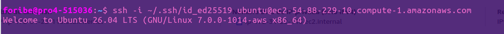
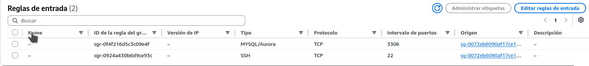

 
 
 
1. Crear un par de claves
ssh-keygen -t ed25519 -C "prueba"

2. Instalar la clave pública y comprobar el acceso
```bash
ssh-copy-id -f -i ~/.ssh/id_ed25519.pub \
-o "IdentityFile=$HOME/Baixades/arbolespaiporta.pem" \
-o IdentitiesOnly=yes \
ubuntu@ec2-54-88-229-10.compute-1.amazonaws.com
```





# Práctica 1b: Despliegue de frontend y backend en dos instancias EC2

Grupos de seguridad:


Destino: todos
