Florencia Oribe

# Práctica 1: 

## Práctica 1a:
## Despliegue de PaiportaArbolado en una instancia EC2 de AWS

Datos de EC2:
- **Imagen:** Ubuntu server 26.04.
- **Tipo de instancia:** t3.micro
- **AMI:** Amazon Linux 2023 kernel-6.18
- **Zona:** us-east-1c
- **IP:** 54.88.229.10
- **Almacenamiento:** Volumen de 8GiB
- **Grupo de seguridad:** Nos fijamos que grupo usa y agregamos las reglas que encesitemos. EN este caso ssh, http y https donde habilitamos el acceso desde todos lados con 0.0.0.0/0.

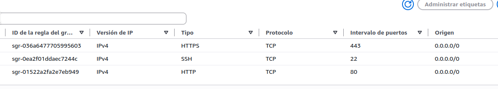


### Comprobaciones
#### 1. Nos conectamos a traves de:
```bash
ssh -i "arbolespaiporta.pem" ubuntu@ec2-54-88-229-10.compute-1.amazonaws.com
```

- 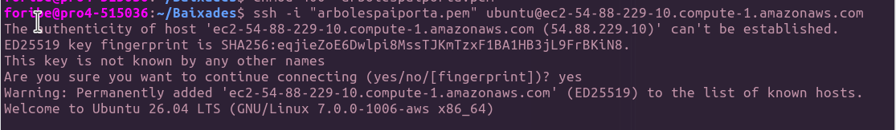
- 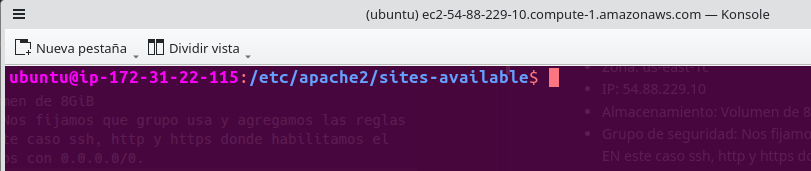


Siendo arbolespaiprota.pem el par de claves que henmos creado para poder acceder.


#### 2. Actualizamos la instancia:
- 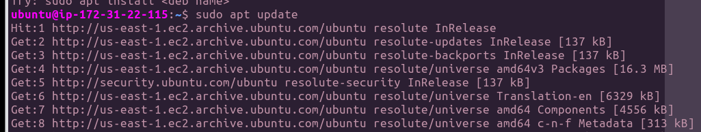


#### 3. Practica 0      
Para realizar el despliegue de la aplicación web, utilizaremos los archivos y la configuración de la **Práctica 0**. En esta ocasión, sustituiremos el dominio local `arboles.paiporta.local` por el dominio público **`flooritej.yatat.es`**.

Para ello, comenzaremos clonando el repositorio de GitHub mediante el comando `git clone`, donde tenemos almacenados todos los archivos de la práctica anterior.

Una vez descargado el repositorio, colocaremos los archivos en sus directorios correspondientes y adaptaremos las configuraciones necesarias para que la aplicación funcione correctamente en la instancia de AWS.
-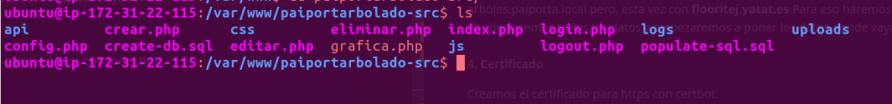

COnfiguracion del virtual host de apache:
*arboles.conf:*
```bash
<VirtualHost *:80>
    ServerName flooritej.yatat.es

    DocumentRoot /var/www/paiportarbolado-src
    <Directory /var/www/paiportarbolado-src>
        AllowOverride All
        Require all granted
    </Directory>

    ErrorLog ${APACHE_LOG_DIR}/arboles_error.log
    CustomLog ${APACHE_LOG_DIR}/arboles_access.log combined
RewriteEngine on
RewriteCond %{SERVER_NAME} =flooritej.yatat.es
RewriteRule ^ https://%{SERVER_NAME}%{REQUEST_URI} [END,NE,R=permanent]
</VirtualHost>


```
#### 4. Certificado
Creamos el certificado para https con certbot.
```bash
certbot --apache -d flooritej.yatat.es
```

- 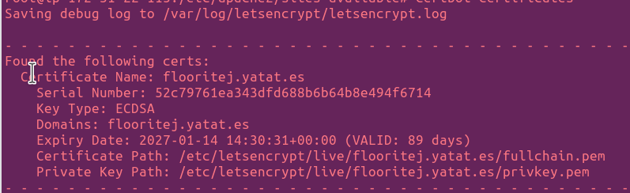

Una vez creado el certbot vemos que en los virtual host habilitados aparece otro fichero creado por certbot que seria https redirigo a http.

```bash
<IfModule mod_ssl.c>
<VirtualHost *:443>
    ServerName flooritej.yatat.es

    DocumentRoot /var/www/paiportarbolado-src
    <Directory /var/www/paiportarbolado-src>
        AllowOverride All
        Require all granted
    </Directory>

    ErrorLog ${APACHE_LOG_DIR}/arboles_error.log
    CustomLog ${APACHE_LOG_DIR}/arboles_access.log combined

SSLCertificateFile /etc/letsencrypt/live/flooritej.yatat.es/fullchain.pem
SSLCertificateKeyFile /etc/letsencrypt/live/flooritej.yatat.es/privkey.pem
Include /etc/letsencrypt/options-ssl-apache.conf
</VirtualHost>
</IfModule>

```

- 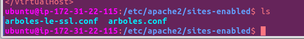

Tras completar todos los pasos de configuración y despliegue, comprobamos que la aplicación web funciona correctamente. Podemos acceder a ella a través del dominio configurado, visualizar los árboles almacenados en la base de datos, añadir nuevos registros e iniciar sesión con las credenciales correspondientes.

- 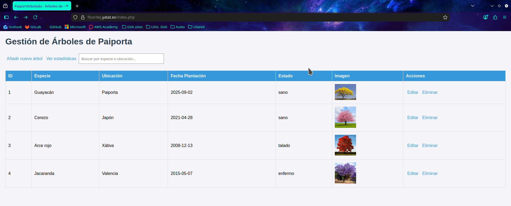


# Crear un par de claves
ssh-keygen -t ed25519 -C "prueba"

2. Instalar la clave pública y comprobar el acceso
```bash
ssh-copy-id -f -i ~/.ssh/id_ed25519.pub \
-o "IdentityFile=$HOME/Baixades/arbolespaiporta.pem" \
-o IdentitiesOnly=yes \
ubuntu@ec2-54-88-229-10.compute-1.amazonaws.com
```


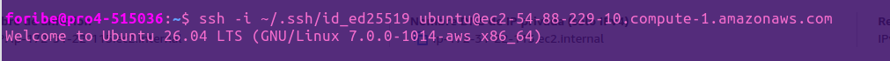


# Práctica 1b: Despliegue de frontend y backend en dos instancias EC2

Grupos de seguridad:
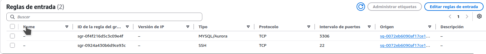

Destino: todos

- COmprobamos que tenemos conexion entre frontend y backend: 
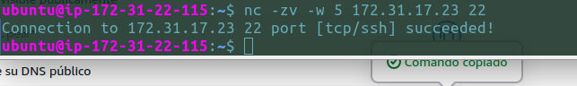

### Backend:


Desde tu ordenador Linux, abre una terminal nueva y ejecuta:
```bash
ssh -i arbolespaiporta.pem \
-J ubuntu@54.88.229.10 \
-R 1080 \
ubuntu@172.31.17.23
```


Este comando hace que el backend pueda utilizar la conexión a Internet de tu ordenador mediante un proxy SOCKS.


Instalar MariaDB
Si el paso anterior funciona, ejecuta en el backend:
``` bash 
apt-get \
-o Acquire::http::Proxy="socks5h://127.0.0.1:1080/" \
-o Acquire::https::Proxy="socks5h://127.0.0.1:1080/" \
update
```

Y después:
```bash
apt-get \
-o Acquire::http::Proxy="socks5h://127.0.0.1:1080/" \
-o Acquire::https::Proxy="socks5h://127.0.0.1:1080/" \
install mariadb-server -y
```

#### Paso 3. Configurar MariaDB en el backend
Necesitamos que MariaDB acepte conexiones a través de la red privada de AWS.
Accedemos a : nano /etc/mysql/mariadb.conf.d/50-server.cnf y modificamos el bind-address por la ip del backend.

Reiniciamos mariadb 
```bash
systemctl restart mariadb
```


Crear el usuario en el backend.
Pero ahora debes sustituir localhost por la IP privada del frontend, porque PHP y MariaDB están en instancias diferentes.

```sql
CREATE USER 'user_bd'@'172.31.22.115' IDENTIFIED BY '1';
```

Puedes mantener el mismo nombre de usuario y la contraseña anterior si lo necesitas, aunque es recomendable utilizar una contraseña segura.


Asignarle permisos
GRANT ALL PRIVILEGES ON PaiportArbolado.* TO 'user_bd'@'172.31.22.115';


Creamos archivo para guardar la contraseña. En /etc/paiportarbolado-db.php. En archivo de configuración no público, con permisos restringidos y excluido del
repositorio.
sudo chown root:www-data /etc/paiportarbolado-db.php
sudo chmod 640 /etc/paiportarbolado-db.php

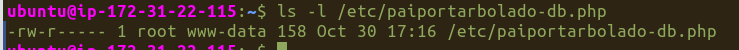


<?php
// Database config
define('DB_HOST', '127.0.0.1');
define('DB_USER', 'user_bd');  
define('DB_PASS', 'passwdbd'); 
define('DB_NAME', 'PaiportArbolado');

// Database conection
$conn = new mysqli(DB_HOST, DB_USER, DB_PASS, DB_NAME);

if ($conn->connect_error) {
    die("ConnectError: " . $conn->connect_error);
}

// Path for Logs
define('LOG_FILE', __DIR__ . '/logs/actions.log');

// Functions
function registerAction($action, $user) {
    $logEntry = date('[Y-m-d H\:i\:s]') . " - $user: $action\n";
    file_put_contents(LOG_FILE, $logEntry, FILE_APPEND);
}
?>


Paso siguiente: exportar la base de datos
En el frontend (172.31.22.115) ejecuta:
sudo mysqldump --single-transaction --no-tablespaces \
PaiportArbolado > ~/PaiportArbolado.sql


Este comando hace una copia de las tablas arboles y users, incluyendo sus datos, sin borrar la base original.

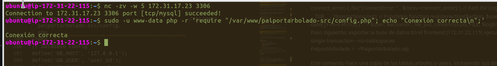
