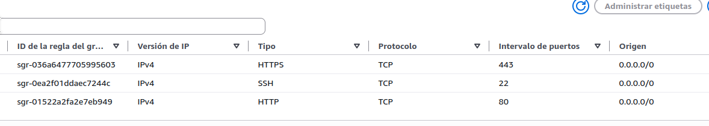
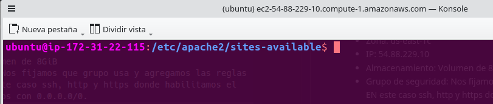
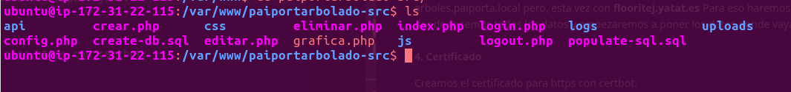
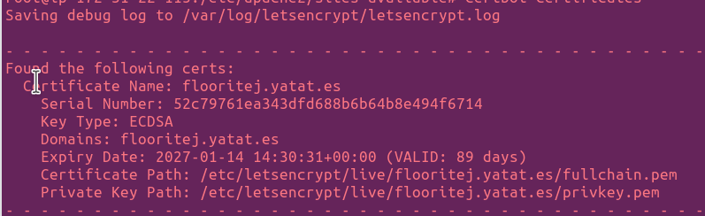
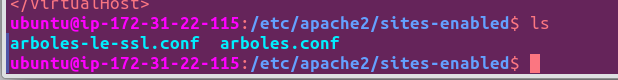
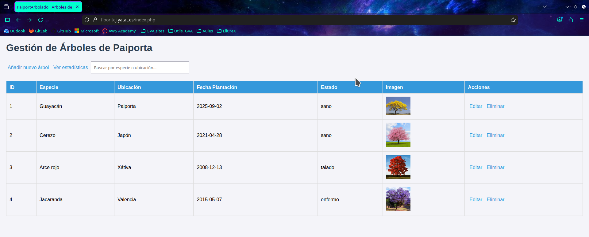

Florencia Oribe

# Práctica 1: 

## Práctica 1a:
## Despliegue de PaiportaArbolado en una instancia EC2 de AWS

Datos de EC2:
- **Imagen:** Ubuntu server 26.04.
- **Tipo de instancia:** t3.micro
- **AMI:** Amazon Linux 2023 kernel-6.18
- **Zona:** us-east-1c
- **IP:** 54.88.229.10
- **Almacenamiento:** Volumen de 8GiB
- **Grupo de seguridad:** Nos fijamos que grupo usa y agregamos las reglas que encesitemos. EN este caso ssh, http y https donde habilitamos el acceso desde todos lados con 0.0.0.0/0.




### Comprobaciones
#### 1. Nos conectamos a traves de:
```bash
ssh -i "arbolespaiporta.pem" ubuntu@ec2-54-88-229-10.compute-1.amazonaws.com
```

- 
- 


Siendo arbolespaiprota.pem el par de claves que henmos creado para poder acceder.


#### 2. Actualizamos la instancia:
- 


#### 3. Practica 0      
Para realizar el despliegue de la aplicación web, utilizaremos los archivos y la configuración de la **Práctica 0**. En esta ocasión, sustituiremos el dominio local `arboles.paiporta.local` por el dominio público **`flooritej.yatat.es`**.

Para ello, comenzaremos clonando el repositorio de GitHub mediante el comando `git clone`, donde tenemos almacenados todos los archivos de la práctica anterior.

Una vez descargado el repositorio, colocaremos los archivos en sus directorios correspondientes y adaptaremos las configuraciones necesarias para que la aplicación funcione correctamente en la instancia de AWS.
-

COnfiguracion del virtual host de apache:
*arboles.conf:*
```bash
<VirtualHost *:80>
    ServerName flooritej.yatat.es

    DocumentRoot /var/www/paiportarbolado-src
    <Directory /var/www/paiportarbolado-src>
        AllowOverride All
        Require all granted
    </Directory>

    ErrorLog ${APACHE_LOG_DIR}/arboles_error.log
    CustomLog ${APACHE_LOG_DIR}/arboles_access.log combined
RewriteEngine on
RewriteCond %{SERVER_NAME} =flooritej.yatat.es
RewriteRule ^ https://%{SERVER_NAME}%{REQUEST_URI} [END,NE,R=permanent]
</VirtualHost>


```
#### 4. Certificado
Creamos el certificado para https con certbot.
```bash
certbot --apache -d flooritej.yatat.es
```

- 

Una vez creado el certbot vemos que en los virtual host habilitados aparece otro fichero creado por certbot que seria https redirigo a http.

```bash
<IfModule mod_ssl.c>
<VirtualHost *:443>
    ServerName flooritej.yatat.es

    DocumentRoot /var/www/paiportarbolado-src
    <Directory /var/www/paiportarbolado-src>
        AllowOverride All
        Require all granted
    </Directory>

    ErrorLog ${APACHE_LOG_DIR}/arboles_error.log
    CustomLog ${APACHE_LOG_DIR}/arboles_access.log combined

SSLCertificateFile /etc/letsencrypt/live/flooritej.yatat.es/fullchain.pem
SSLCertificateKeyFile /etc/letsencrypt/live/flooritej.yatat.es/privkey.pem
Include /etc/letsencrypt/options-ssl-apache.conf
</VirtualHost>
</IfModule>

```

- 

Tras completar todos los pasos de configuración y despliegue, comprobamos que la aplicación web funciona correctamente. Podemos acceder a ella a través del dominio configurado, visualizar los árboles almacenados en la base de datos, añadir nuevos registros e iniciar sesión con las credenciales correspondientes.

- 
