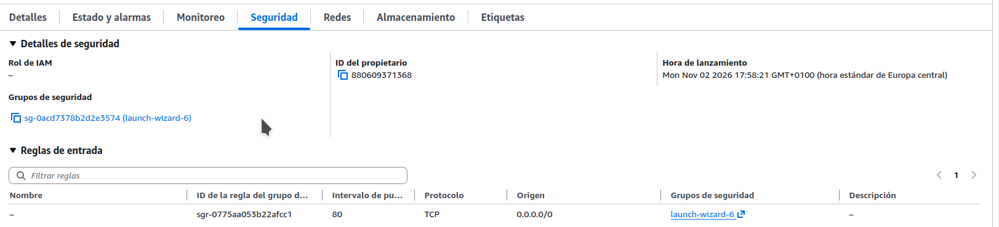
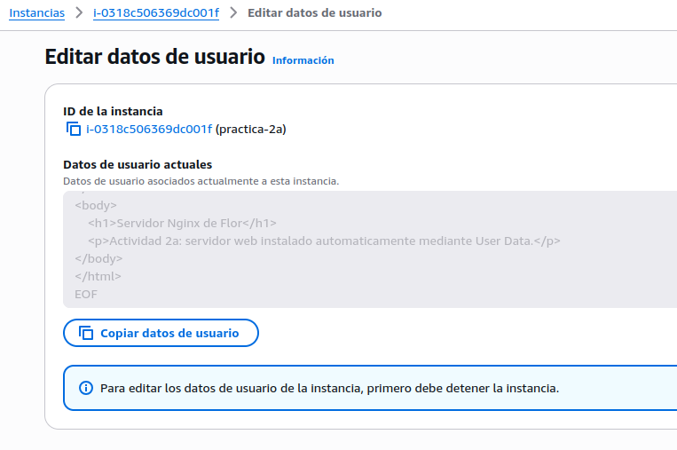
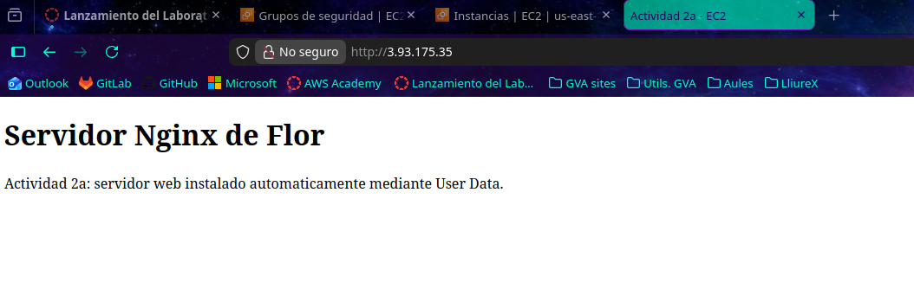

# Actividad 2a: Datos de usuario en el lanzamiento de una instancia EC2

1. Creación de la instancia

Creamos una instancia EC2 con Ubuntu 26.04, IP pública y un grupo de seguridad que permite HTTP (puerto 80).

- 

2. Configuración de User Data

En Detalles avanzados → Datos de usuario, añadimos un script para instalar Nginx y crear una página HTML automáticamente.

- 

3. Comprobación

Accedemos desde el navegador a http://3.93.175.35 y comprobamos que aparece nuestra página web correctamente.

- 

4. Conclusión

Hemos conseguido instalar Nginx y publicar una web automáticamente, sin necesidad de conectarnos por SSH.

