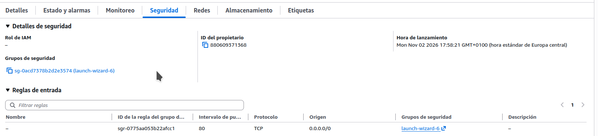
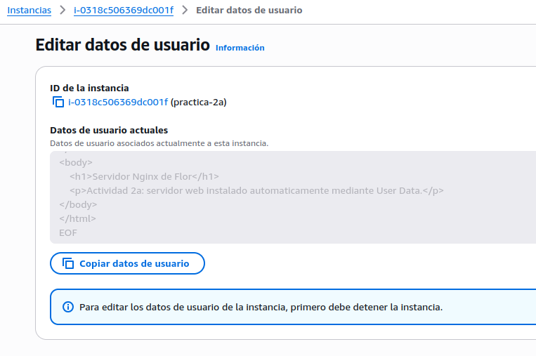
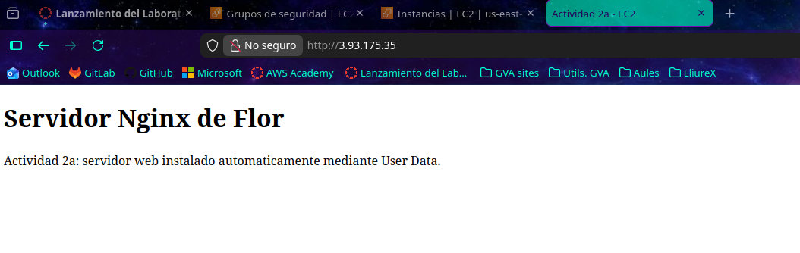
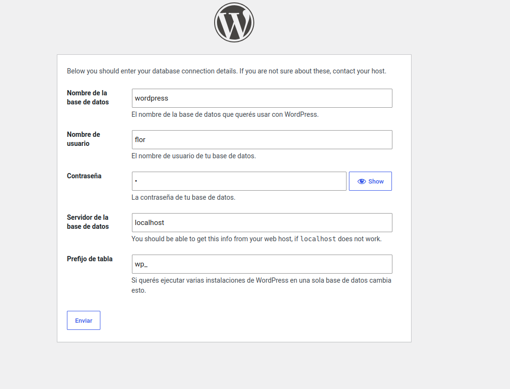
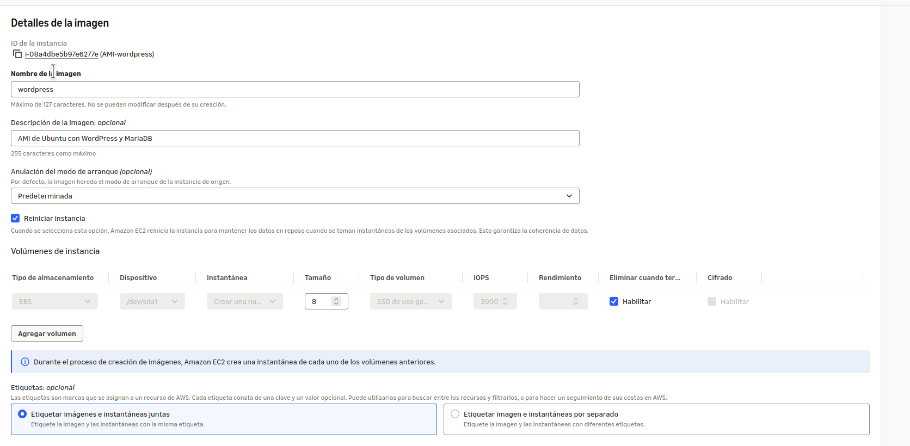

# Actividad 2a: Datos de usuario en el lanzamiento de una instancia EC2


1. Creación de la instancia

Creamos una instancia EC2 con Ubuntu 26.04, IP pública y un grupo de seguridad que permite HTTP (puerto 80).

- 

2. Configuración de User Data

En Detalles avanzados → Datos de usuario, añadimos un script para instalar Nginx y crear una página HTML automáticamente.

- 


3. Comprobación

Accedemos desde el navegador a http://3.93.175.35 y comprobamos que aparece nuestra página web correctamente.

- 

4. Conclusión

Hemos conseguido instalar Nginx y publicar una web automáticamente, sin necesidad de conectarnos por SSH.


# Actividad 2b: Creación de una AMI con WordPress

## 1. Objetivo

El objetivo de esta práctica es instalar WordPress en una instancia EC2 de AWS, crear una AMI a partir de ella y lanzar una segunda instancia para comprobar que se conservan la aplicación y sus datos.

Una **AMI (Amazon Machine Image)** es una plantilla que permite crear nuevas instancias EC2 con el sistema operativo, las aplicaciones y los datos almacenados en los volúmenes incluidos.

## 2. Creación y configuración de la instancia EC2

Creamos una instancia EC2 con Ubuntu Server y configuramos un grupo de seguridad con las siguientes reglas de entrada:

| Puerto | Servicio | Origen |
|---|---|---|
| 22 | SSH | Nuestra IP pública (/32) |
| 80 | HTTP | Nuestra IP pública (/32) |

Estas reglas permiten acceder a la instancia mediante SSH y visualizar WordPress desde el navegador.

También mantenemos las reglas de salida para permitir la conexión a Internet.


## 3. Instalación de WordPress

Nos conectamos a la instancia mediante SSH e instalamos los servicios necesarios:

- **Apache:** servidor web.
- **PHP:** lenguaje utilizado por WordPress.
- **MariaDB:** sistema gestor de bases de datos.
- **WordPress:** aplicación web.

Actualizamos los repositorios e instalamos los paquetes:

```bash
sudo apt update
sudo apt install mariadb-server php libapache2-mod-php php-mysql php-curl php-gd php-mbstring php-xml php-zip php-intl wget tar -y
```

Comprobamos que Apache y MariaDB están activos:

```bash
sudo systemctl status apache2
sudo systemctl status mariadb
```

### 3.1. Creación de la base de datos

Accedemos a MariaDB:

```bash
sudo mariadb
```

Creamos la base de datos `wordpress` y un usuario llamado `flor`, al que concedemos permisos sobre ella.

```sql
CREATE DATABASE wordpress;
CREATE USER 'flor'@'localhost' IDENTIFIED BY '1';
GRANT ALL PRIVILEGES ON wordpress.* TO 'flor'@'localhost';
EXIT;
```

*La contraseña se sustituye por la utilizada durante la práctica.*

### 3.2. Instalación de WordPress

Descargamos WordPress y lo copiamos al directorio web de Apache:

```bash
cd /tmp
wget https://wordpress.org/latest.tar.gz
tar -xzvf latest.tar.gz
sudo cp -a wordpress/. /var/www/html/
```

Configuramos los permisos y eliminamos la página predeterminada de Apache:

```bash
sudo chown -R www-data:www-data /var/www/html
sudo find /var/www/html -type d -exec chmod 755 {} \;
sudo find /var/www/html -type f -exec chmod 644 {} \;
sudo rm /var/www/html/index.html
sudo systemctl restart apache2
```

Comprobamos el funcionamiento mediante:

```bash
curl -I http://localhost
```

Apache devuelve una redirección HTTP 302 hacia el asistente de instalación de WordPress.

Accedemos desde el navegador mediante la IP pública de la instancia y completamos la instalación, utilizando la base de datos `wordpress` y el usuario `flor`.

**No fue necesario crear un VirtualHost adicional**, ya que Apache utiliza por defecto el directorio `/var/www/html`.


## 4. Creación de una entrada de prueba

Desde el panel de administración de WordPress creamos una entrada con los siguientes datos:

- **Título:** AMI DE WORDPRESS
- **Contenido:** clonar

Publicamos la entrada para comprobar posteriormente que la AMI conserva los datos de WordPress.


## 5. Creación de la AMI

Accedemos a:

**EC2 → Instancias → Acciones → Imagen y plantillas → Crear imagen**

Configuramos la imagen:

| Parámetro | Valor |
|---|---|
| Nombre | wordpress |
| Descripción | AMI de Ubuntu con WordPress y MariaDB |
| Almacenamiento | EBS de 8 GiB |
| Visibilidad | Privada |

Permitimos el reinicio de la instancia durante la creación para mejorar la consistencia de los datos.

AWS genera una AMI respaldada por una instantánea del volumen EBS.

La AMI permanece inicialmente en estado **Pendiente** hasta completar su creación.

Comprobamos en el apartado de instantáneas que el proceso se ha completado y verificamos que la AMI está disponible para lanzar nuevas instancias.



## 6. Lanzamiento de una instancia clonada

Desde **EC2 → AMI**, seleccionamos nuestra imagen `wordpress` y pulsamos **Lanzar instancia a partir de una AMI**.

Creamos una nueva instancia llamada `ami-prueba-clon`, manteniendo una configuración compatible y permitiendo los accesos HTTP y SSH desde nuestra IP autorizada.

Una vez iniciada, esperamos a que supere las comprobaciones de estado de AWS.

La instancia clonada obtiene una dirección IP pública diferente a la original:

- **Instancia original:** 54.226.108.87
- **Instancia clonada:** 34.234.95.95


## 7. Comprobación de la clonación

Accedemos desde el navegador a la IP pública del clon:

```text
http://34.234.95.95
```

Comprobamos que WordPress funciona correctamente y que aparece la entrada **«AMI DE WORDPRESS»**, creada anteriormente en la instancia original.

Esto demuestra que la AMI ha conservado tanto los archivos de WordPress como la base de datos MariaDB.

También probamos el acceso SSH al clon:

```bash
ssh -i "vockey.pem" ubuntu@34.234.95.95
```

Inicialmente intentamos conectarnos como `root`, pero Ubuntu nos indicó que debíamos utilizar el usuario `ubuntu`.


## 8. Conclusión

En esta práctica hemos aprendido a crear una AMI personalizada en AWS a partir de una instancia EC2 con WordPress instalado.

Hemos comprobado que podemos utilizar esta imagen para lanzar una nueva instancia sin necesidad de reinstalar Apache, PHP, MariaDB ni WordPress.

Además, hemos verificado que **la nueva instancia conserva la entrada creada en la original**, demostrando que la AMI permite replicar una configuración previamente preparada.

La instancia original y el clon son recursos EC2 diferentes, aunque procedan de la misma imagen.
