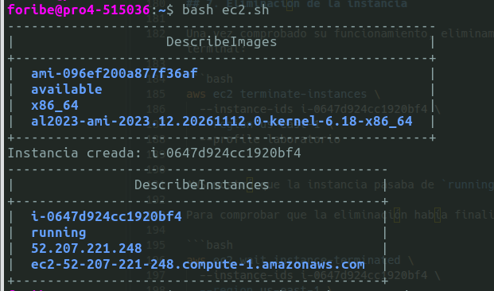
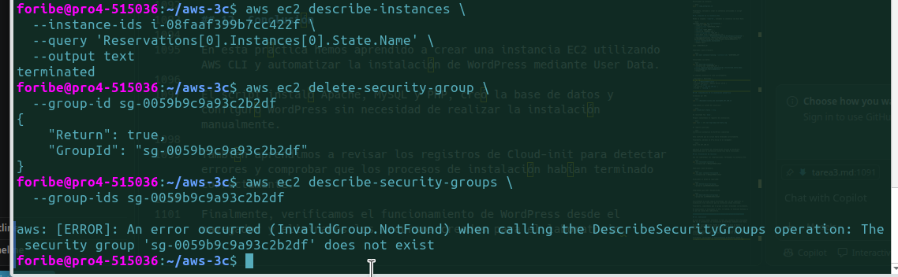

# Actividad 3A: Crear una instancia EC2 con AWS CLI

## 1. Objetivo

El objetivo de esta práctica es aprender a crear y administrar una instancia EC2 desde la terminal utilizando **AWS CLI**, sin necesidad de utilizar la consola gráfica de AWS.

Para ello, instalaremos AWS CLI, configuraremos las credenciales del laboratorio, crearemos una instancia mediante un script y finalmente la eliminaremos.

## 2. Instalación de AWS CLI

Primero instalamos AWS CLI en nuestro equipo local con Linux.

Descargamos el instalador oficial:

```bash
sudo apt update
sudo apt install curl unzip -y

curl "https://awscli.amazonaws.com/awscli-exe-linux-x86_64.zip" -o "awscliv2.zip"

unzip awscliv2.zip
sudo ./aws/install
```

Comprobamos que se ha instalado correctamente:

```bash
aws --version
```

El resultado mostró que teníamos instalada la versión `aws-cli/2.40.3`.

## 3. Configuración de las credenciales

Iniciamos el laboratorio de AWS Academy y accedimos a **AWS Details → AWS CLI → Show** para obtener las credenciales temporales.

Configuramos un perfil llamado `laboratorio`:

```bash
aws configure --profile laboratorio
```

Introdujimos las claves proporcionadas por AWS Academy y configuramos:

- **Región:** `us-east-1`
- **Formato de salida:** `json`

Después, editamos el archivo de credenciales:

```bash
nano ~/.aws/credentials
```

Añadimos el token de sesión al perfil `laboratorio`, necesario para autenticar las peticiones con credenciales temporales.

Comprobamos la conexión:

```bash
aws sts get-caller-identity --profile laboratorio
```

Inicialmente apareció el error `SignatureDoesNotMatch`, debido a un problema con las credenciales. Tras corregirlas, el comando devolvió correctamente la información de la identidad del laboratorio.


## 4. Comprobaciones previas

Antes de crear la instancia comprobamos que teníamos disponibles los recursos necesarios.

### 4.1. Comprobar el par de claves SSH

```bash
aws ec2 describe-key-pairs \
  --key-names vockey \
  --region us-east-1 \
  --profile laboratorio
```

El resultado confirmó que el par de claves `vockey` existía en la región.

### 4.2. Comprobar el tipo de instancia

```bash
aws ec2 describe-instance-type-offerings \
  --location-type region \
  --filters Name=location,Values=us-east-1 Name=instance-type,Values=t2.micro \
  --region us-east-1 \
  --profile laboratorio
```

Comprobamos que el tipo `t2.micro` estaba disponible en `us-east-1`.


## 5. Creación del script ec2.sh

Creamos un script para automatizar la creación de la instancia:

```bash
nano ec2.sh
```

Añadimos el siguiente contenido:

```bash
#!/usr/bin/env bash
set -euo pipefail

AWS_REGION="us-east-1"
AWS_PROFILE="laboratorio"
INSTANCE_TYPE="t2.micro"
KEY_NAME="vockey"

# Obtener la AMI de Amazon Linux 2023
AMI_ID=$(aws ssm get-parameter \
  --name /aws/service/ami-amazon-linux-latest/al2023-ami-kernel-default-x86_64 \
  --query 'Parameter.Value' \
  --output text \
  --region "$AWS_REGION" \
  --profile "$AWS_PROFILE")

# Comprobar la AMI
aws ec2 describe-images \
  --image-ids "$AMI_ID" \
  --region "$AWS_REGION" \
  --query 'Images[0].[ImageId,State,Architecture,Name]' \
  --output table \
  --profile "$AWS_PROFILE"

# Crear la instancia
INSTANCE_ID=$(aws ec2 run-instances \
  --image-id "$AMI_ID" \
  --count 1 \
  --instance-type "$INSTANCE_TYPE" \
  --key-name "$KEY_NAME" \
  --region "$AWS_REGION" \
  --profile "$AWS_PROFILE" \
  --query 'Instances[0].InstanceId' \
  --output text)

printf 'Instancia creada: %s\n' "$INSTANCE_ID"

# Esperar a que se inicie
aws ec2 wait instance-running \
  --instance-ids "$INSTANCE_ID" \
  --region "$AWS_REGION" \
  --profile "$AWS_PROFILE"

# Mostrar los datos de la instancia
aws ec2 describe-instances \
  --instance-ids "$INSTANCE_ID" \
  --region "$AWS_REGION" \
  --query 'Reservations[0].Instances[0].[InstanceId,State.Name,PublicIpAddress,PublicDnsName]' \
  --output table \
  --profile "$AWS_PROFILE"
```

Este script obtiene la AMI de Amazon Linux 2023, crea una instancia `t2.micro`, espera a que arranque y muestra su información.

## 6. Ejecución del script

Ejecutamos:

```bash
bash ec2.sh
```

El script creó correctamente una instancia con los siguientes datos:

| Parámetro | Resultado |
|---|---|
| Sistema operativo | Amazon Linux 2023 |
| Tipo de instancia | t2.micro |
| Región | us-east-1 |
| ID | i-0647d924cc1920bf4 |
| IP pública | 52.207.221.248 |
| Estado | running |

Accedimos a la consola gráfica de AWS y comprobamos que la instancia aparecía en ejecución.

- 

## 7. Eliminación de la instancia

Una vez comprobado su funcionamiento, eliminamos la instancia desde la terminal:

```bash
aws ec2 terminate-instances \
  --instance-ids i-0647d924cc1920bf4 \
  --region us-east-1 \
  --profile laboratorio
```

AWS mostró que la instancia pasaba de `running` a `shutting-down`.

Para comprobar que la eliminación había finalizado, ejecutamos:

```bash
aws ec2 wait instance-terminated \
  --instance-ids i-0647d924cc1920bf4 \
  --region us-east-1 \
  --profile laboratorio
```

El comando terminó sin errores, confirmando que la instancia se había eliminado correctamente.


## 8. Conclusión

En esta práctica hemos aprendido a utilizar **AWS CLI para administrar recursos de AWS desde Linux**.

Hemos configurado las credenciales temporales de AWS Academy, comprobado los recursos necesarios y creado una instancia EC2 mediante un script Bash.

Finalmente, verificamos que la instancia se había creado correctamente y la eliminamos utilizando comandos.

Esto demuestra que podemos automatizar la creación y gestión de instancias EC2 sin utilizar la consola gráfica de AWS.


# Actividad 3B: Crear una instancia EC2 con OpenTofu

## 1. Objetivo

El objetivo de esta práctica es aprender a crear y administrar una instancia EC2 en AWS mediante **OpenTofu**, utilizando infraestructura como código (IaC).

A diferencia de AWS CLI, OpenTofu nos permite definir los recursos en archivos de configuración y automatizar su creación y eliminación.

## 2. Instalación de OpenTofu

Primero instalamos OpenTofu en nuestro equipo Linux.

Descargamos el instalador oficial:

```bash
curl --proto '=https' --tlsv1.2 -fsSL https://get.opentofu.org/install-opentofu.sh -o install-opentofu.sh
chmod +x install-opentofu.sh
```

Ejecutamos la instalación:

```bash
./install-opentofu.sh --install-method deb
```

Durante la instalación apareció un error porque el repositorio de GitHub CLI estaba devolviendo un error `404 Not Found`.

Localizamos el repositorio problemático:

```bash
grep -Rn "cli.github.com/packages" /etc/apt/sources.list /etc/apt/sources.list.d/ 2>/dev/null
```

Lo desactivamos temporalmente sin eliminar Git ni los proyectos existentes:

```bash
sudo mv /etc/apt/sources.list.d/github-cli2.list /etc/apt/sources.list.d/github-cli2.list.disabled
sudo apt update
```

Repetimos la instalación y comprobamos que OpenTofu estaba funcionando:

```bash
tofu version
```

## 3. Conexión con AWS Academy

Reutilizamos el perfil `laboratorio` que habíamos configurado en la práctica anterior de AWS CLI.

Activamos el perfil:

```bash
export AWS_PROFILE=laboratorio
```

Comprobamos la conexión:

```bash
aws sts get-caller-identity
```

AWS devolvió correctamente los datos de la identidad del laboratorio, confirmando que las credenciales temporales funcionaban.

## 4. Comprobación de la infraestructura de AWS

Antes de crear la instancia, comprobamos que teníamos una VPC y una subred disponibles en la región `us-east-1`.

### 4.1. Comprobar la VPC

```bash
aws ec2 describe-vpcs \
  --filters Name=isDefault,Values=true \
  --region us-east-1 \
  --query 'Vpcs[*].[VpcId,State]' \
  --output table
```

Obtuvimos la VPC predeterminada:

`vpc-0a723d7da64563d06`

### 4.2. Comprobar las subredes

```bash
aws ec2 describe-subnets \
  --filters Name=default-for-az,Values=true \
  --region us-east-1 \
  --query 'Subnets[*].[SubnetId,VpcId,AvailabilityZone,MapPublicIpOnLaunch]' \
  --output table
```

Encontramos seis subredes disponibles y seleccionamos:

- **Subred:** `subnet-0899b5aa3dba5fa1a`
- **Zona de disponibilidad:** `us-east-1a`
- **Asignación de IP pública:** habilitada.

### 4.3. Comprobar la conexión a Internet

Consultamos la tabla de rutas asociada a la subred:

```bash
aws ec2 describe-route-tables \
  --filters Name=association.subnet-id,Values=subnet-0899b5aa3dba5fa1a \
  --region us-east-1 \
  --query 'RouteTables[*].{RouteTableId:RouteTableId,DefaultRoute:Routes[?DestinationCidrBlock==`0.0.0.0/0`].[GatewayId,State]}' \
  --output json
```

El resultado fue `[]`, por lo que comprobamos la tabla de rutas principal de la VPC:

```bash
aws ec2 describe-route-tables \
  --filters Name=vpc-id,Values=vpc-0a723d7da64563d06 Name=association.main,Values=true \
  --region us-east-1 \
  --query 'RouteTables[*].{RouteTableId:RouteTableId,DefaultRoute:Routes[?DestinationCidrBlock==`0.0.0.0/0`].[GatewayId,State]}' \
  --output json
```

Confirmamos que existía una ruta `0.0.0.0/0` hacia el Internet Gateway `igw-0f1f474e202a52ae6`, con estado `active`.

Esto permitió comprobar que la subred seleccionada tenía salida a Internet.


## 5. Creación del proyecto OpenTofu

Creamos una carpeta independiente para almacenar los archivos de configuración:

```bash
mkdir ~/ec2-tofu
cd ~/ec2-tofu
```

Dentro de ella creamos los siguientes archivos:

| Archivo | Función |
|---|---|
| `main.tf` | Define la EC2 y el grupo de seguridad |
| `variables.tf` | Declara las variables del proyecto |
| `outputs.tf` | Muestra el ID, la IP y el DNS de la instancia |
| `terraform.tfvars` | Contiene los valores utilizados por las variables |
| `.gitignore` | Evita subir archivos sensibles o temporales a Git |

### 5.1. Archivo main.tf

Creamos el archivo:

```bash
nano main.tf
```

Introdujimos la configuración necesaria para utilizar el proveedor AWS, consultar la AMI de Amazon Linux 2023 y crear los recursos.

```hcl
terraform {
  required_providers {
    aws = {
      source  = "hashicorp/aws"
      version = "~> 5.0"
    }
  }
}

provider "aws" {
  region = var.aws_region
}

data "aws_subnet" "selected" {
  id = var.subnet_id
}

data "aws_ssm_parameter" "amazon_linux_2023" {
  name = "/aws/service/ami-amazon-linux-latest/al2023-ami-kernel-default-x86_64"
}

resource "aws_security_group" "ec2" {
  name        = "${var.project_name}-sg"
  description = "SSH limitado a la IP del alumno"
  vpc_id      = data.aws_subnet.selected.vpc_id

  ingress {
    description = "SSH desde la IP autorizada"
    from_port   = 22
    to_port     = 22
    protocol    = "tcp"
    cidr_blocks = [var.ssh_cidr]
  }

  egress {
    description = "Salida para actualizaciones y respuestas"
    from_port   = 0
    to_port     = 0
    protocol    = "-1"
    cidr_blocks = ["0.0.0.0/0"]
  }

  tags = {
    Name    = "${var.project_name}-sg"
    Project = var.project_name
  }
}

resource "aws_instance" "ec2" {
  ami                         = data.aws_ssm_parameter.amazon_linux_2023.value
  instance_type               = var.instance_type
  subnet_id                   = var.subnet_id
  associate_public_ip_address = true
  key_name                    = var.key_name
  vpc_security_group_ids      = [aws_security_group.ec2.id]

  root_block_device {
    encrypted   = true
    volume_type = "gp3"
    volume_size = 8
  }

  tags = {
    Name    = var.project_name
    Project = var.project_name
  }
}
```

Esta configuración crea una instancia EC2 y un grupo de seguridad que permite únicamente SSH desde nuestra IP pública autorizada.

### 5.2. Archivo variables.tf

Declaramos las variables necesarias:

```hcl
variable "aws_region" {
  type    = string
  default = "us-east-1"
}

variable "project_name" {
  type = string
}

variable "subnet_id" {
  type = string
}

variable "key_name" {
  type = string
}

variable "ssh_cidr" {
  type = string

  validation {
    condition = can(cidrnetmask(var.ssh_cidr)) && try(
      tonumber(split("/", var.ssh_cidr)[1]) == 32, false
    )
    error_message = "La IP debe tener mascara /32"
  }
}

variable "instance_type" {
  type    = string
  default = "t2.micro"
}
```

### 5.3. Archivo outputs.tf

Configuramos las salidas para obtener los datos de nuestra instancia:

```hcl
output "instance_id" {
  value = aws_instance.ec2.id
}

output "public_ip" {
  value = aws_instance.ec2.public_ip
}

output "public_dns" {
  value = aws_instance.ec2.public_dns
}
```

### 5.4. Archivo terraform.tfvars

Introdujimos los valores de nuestro laboratorio:

```hcl
project_name  = "ec2-flor"
subnet_id     = "subnet-0899b5aa3dba5fa1a"
key_name      = "vockey"
ssh_cidr      = "TU_IP_PUBLICA/32"
instance_type = "t2.micro"
```

Sustituimos `TU_IP_PUBLICA` por nuestra dirección pública real, obtenida mediante:

```bash
curl -4 https://checkip.amazonaws.com
```

### 5.5. Archivo .gitignore

Creamos un archivo `.gitignore` para evitar subir el estado de OpenTofu y las variables locales a Git:

```gitignore
.terraform/
*.tfstate
*.tfstate.*
*.tfvars
*.plan
crash.log
```


## 6. Inicialización y validación

Una vez creados los archivos, ejecutamos:

```bash
tofu fmt
tofu init
tofu validate
```

Inicialmente apareció un error `Duplicate variable declaration`, porque habíamos duplicado la declaración de variables en `outputs.tf`.

Corregimos el contenido del archivo y repetimos los comandos.

Finalmente obtuvimos:

```text
OpenTofu has been successfully initialized!
Success! The configuration is valid.
```

Esto confirmó que el proyecto estaba preparado.


## 7. Creación de la instancia EC2

Primero generamos un plan para comprobar los recursos que OpenTofu iba a crear:

```bash
tofu plan -out=ec2.plan
```

El resultado fue:

```text
Plan: 2 to add, 0 to change, 0 to destroy.
```

El plan indicaba que se crearían una instancia EC2 y un grupo de seguridad.

Después aplicamos el plan:

```bash
tofu apply ec2.plan
```

OpenTofu creó correctamente ambos recursos:

```text
Apply complete! Resources: 2 added, 0 changed, 0 destroyed.
```

Los resultados fueron:

| Recurso | Valor |
|---|---|
| Instancia EC2 | `i-07725671ebc1b86e0` |
| Tipo | `t2.micro` |
| Sistema operativo | Amazon Linux 2023 |
| IP pública | `44.214.104.236` |
| Grupo de seguridad | `sg-001d349832ecb9a21` |
| Región | `us-east-1` |


## 8. Comprobación del acceso SSH

Una vez creada la instancia, comprobamos su información mediante AWS CLI:

```bash
aws ec2 describe-instances \
  --instance-ids i-07725671ebc1b86e0 \
  --region us-east-1 \
  --query 'Reservations[0].Instances[0].[InstanceId,State.Name,PublicIpAddress,PublicDnsName,KeyName,SecurityGroups[*].GroupId]' \
  --output table
```

Después nos conectamos mediante SSH utilizando el par de claves `vockey`:

```bash
chmod 400 ~/Baixades/vockey.pem

ssh -i ~/Baixades/vockey.pem ec2-user@44.214.104.236
```

La conexión funcionó correctamente y accedimos a la terminal de **Amazon Linux 2023**.

Esto confirmó que la instancia estaba funcionando y que el grupo de seguridad permitía la conexión SSH desde nuestra IP.

## 9. Eliminación de los recursos

Una vez finalizadas las comprobaciones, salimos de la instancia:

```bash
exit
```

Desde la carpeta del proyecto revisamos los recursos que se eliminarían:

```bash
tofu plan -destroy
```

El plan debía incluir únicamente la instancia EC2 y el grupo de seguridad creados durante esta actividad.

Después ejecutamos:

```bash
tofu destroy
```

Confirmamos la operación escribiendo `yes`.

OpenTofu eliminó los recursos del proyecto, sin necesidad de borrarlos manualmente desde la consola de AWS.


## 10. Conclusión

En esta práctica hemos aprendido a utilizar **OpenTofu para crear infraestructura en AWS mediante archivos de configuración**.

Hemos reutilizado una VPC y una subred existentes, creado una instancia EC2 con Amazon Linux 2023 y configurado un grupo de seguridad que limita el acceso SSH a nuestra IP pública.

También hemos comprobado que la instancia funciona mediante una conexión SSH y finalmente hemos eliminado los recursos utilizando `tofu destroy`.

La principal ventaja de OpenTofu es que permite **definir, reproducir y gestionar nuestra infraestructura de forma automatizada**, sin tener que crear cada recurso manualmente.


### ¿Cuándo cambiarías main.tf?

Cuando se te pida una infraestructura diferente, por ejemplo, añadir otro puerto, crear dos instancias o cambiar el tamaño del disco.

### ¿Cuándo cambiarías terraform.tfvars?
Modiciar cuando se crea otro proyecto con datos actuales.


# Actividad 3C: Instalación de WordPress en AWS con AWS CLI

## 1. Objetivo

El objetivo de esta práctica es crear una instancia EC2 con Ubuntu Server 24.04 e instalar automáticamente **Apache, MySQL, PHP y WordPress** mediante un script de User Data.

Utilizaremos AWS CLI para crear y administrar los recursos desde nuestra terminal Linux.

## 2. Configuración de AWS CLI

Primero iniciamos el laboratorio de AWS Academy y configuramos las credenciales temporales.

Activamos el perfil y la región:

```bash
export AWS_PROFILE="laboratorio"
export AWS_DEFAULT_REGION="us-east-1"
```

Comprobamos la conexión:

```bash
aws sts get-caller-identity
```

## 3. Configuración de variables

Definimos los valores que utilizaremos durante la práctica:

```bash
PROJECT="actividad-3c"
INSTANCE_TYPE="t3.small"
KEY_NAME="vockey"
```

Obtenemos nuestra IP pública:

```bash
MY_IP="$(curl -fsS -4 https://checkip.amazonaws.com | tr -d '\n')/32"
echo "$MY_IP"
```

Utilizamos esta dirección para limitar las conexiones SSH y HTTP a nuestro ordenador.

## 4. Comprobación de la red

Consultamos las VPC disponibles:

```bash
aws ec2 describe-vpcs \
  --query 'Vpcs[*].[VpcId,IsDefault,CidrBlock,State]' \
  --output table
```

Consultamos las subredes:

```bash
aws ec2 describe-subnets \
  --query 'Subnets[*].[SubnetId,VpcId,AvailabilityZone,State,MapPublicIpOnLaunch,CidrBlock]' \
  --output table
```

Seleccionamos los recursos de nuestro laboratorio:

```bash
VPC_ID="vpc-0a723d7da64563d06"
SUBNET_ID="subnet-0899b5aa3dba5fa1a"
```

### Comprobación de la conexión a Internet

Primero consultamos la tabla de rutas asociada a la subred:

```bash
aws ec2 describe-route-tables \
  --filters "Name=association.subnet-id,Values=$SUBNET_ID" \
  --query 'RouteTables[*].{RouteTableId:RouteTableId,DefaultRoute:Routes[?DestinationCidrBlock==`0.0.0.0/0`].[GatewayId,State]}' \
  --output json
```

Como devolvió `[]`, consultamos la tabla principal de la VPC:

```bash
aws ec2 describe-route-tables \
  --filters "Name=vpc-id,Values=$VPC_ID" "Name=association.main,Values=true" \
  --query 'RouteTables[*].{RouteTableId:RouteTableId,DefaultRoute:Routes[?DestinationCidrBlock==`0.0.0.0/0`].[GatewayId,State]}' \
  --output json
```

Comprobamos que existía una ruta `0.0.0.0/0` hacia un Internet Gateway en estado `active`.


## 5. Comprobación del tipo de instancia y clave SSH

Verificamos que `t3.small` estaba disponible:

```bash
aws ec2 describe-instance-type-offerings \
  --location-type region \
  --filters "Name=location,Values=$AWS_DEFAULT_REGION" "Name=instance-type,Values=$INSTANCE_TYPE" \
  --query 'InstanceTypeOfferings[*].[InstanceType,Location]' \
  --output table
```

Comprobamos que existía el par de claves `vockey`:

```bash
aws ec2 describe-key-pairs \
  --key-names "$KEY_NAME" \
  --query 'KeyPairs[*].[KeyName,KeyPairId]' \
  --output table
```

## 6. Creación del grupo de seguridad

Creamos un grupo de seguridad específico para WordPress:

```bash
SG_ID=$(aws ec2 create-security-group \
  --vpc-id "$VPC_ID" \
  --group-name "$PROJECT-sg" \
  --description "SSH y HTTP para WordPress" \
  --query 'GroupId' \
  --output text)

echo "$SG_ID"
```

Añadimos etiquetas:

```bash
aws ec2 create-tags \
  --resources "$SG_ID" \
  --tags "Key=Name,Value=$PROJECT-sg" "Key=Project,Value=$PROJECT"
```

Permitimos SSH (22) únicamente desde nuestra IP:

```bash
aws ec2 authorize-security-group-ingress \
  --group-id "$SG_ID" \
  --protocol tcp \
  --port 22 \
  --cidr "$MY_IP"
```

Permitimos HTTP (80) desde la misma IP:

```bash
aws ec2 authorize-security-group-ingress \
  --group-id "$SG_ID" \
  --protocol tcp \
  --port 80 \
  --cidr "$MY_IP"
```

Comprobamos las reglas:

```bash
aws ec2 describe-security-groups \
  --group-ids "$SG_ID"
```

## 7. Selección de la AMI de Ubuntu

Buscamos una AMI oficial de Ubuntu Server 24.04:

```bash
aws ec2 describe-images \
  --owners 099720109477 \
  --filters \
    "Name=name,Values=ubuntu/images/hvm-ssd-gp3/ubuntu-noble-24.04-amd64-server-*" \
    "Name=state,Values=available" \
  --query 'Images | sort_by(@, &CreationDate)[-1].[ImageId,Name,CreationDate]' \
  --output table
```

Asignamos el ID obtenido:

```bash
AMI_ID="ami-08b275ac6cc5dbefb"
```

Este identificador corresponde a la AMI utilizada en nuestro laboratorio. En otra sesión debemos consultar la AMI vigente.


## 8. Creación del script de instalación

Creamos una carpeta y un archivo para automatizar WordPress:

```bash
mkdir -p ~/aws-3c
cd ~/aws-3c
nano lamp_wordpress.sh
```

El script contiene lo siguiente:

```bash
#!/bin/bash
set -euo pipefail

# Registrar la instalacion
exec > >(tee -a /var/log/lamp-user-data.log) 2>&1

echo "Iniciando instalacion automatica de WordPress"

export DEBIAN_FRONTEND=noninteractive

# Instalar Apache, MySQL y PHP
apt-get update -y

apt-get install -y \
  apache2 mysql-server php libapache2-mod-php \
  php-mysql php-curl php-gd php-mbstring \
  php-xml php-zip php-intl curl tar

systemctl enable --now apache2
systemctl enable --now mysql

# Crear base de datos y usuario
DB_PASSWORD=$(openssl rand -hex 24)

mysql <<SQL
CREATE DATABASE wordpress;
CREATE USER 'wpuser'@'localhost' IDENTIFIED BY '${DB_PASSWORD}';
GRANT ALL PRIVILEGES ON wordpress.* TO 'wpuser'@'localhost';
SQL

umask 077
printf 'Base de datos: wordpress\nUsuario: wpuser\nPassword: %s\n' \
  "$DB_PASSWORD" > /root/wordpress-db-credentials

# Descargar WordPress
cd /tmp
curl -fsSL https://wordpress.org/latest.tar.gz -o wordpress.tar.gz
tar -xzf wordpress.tar.gz

rm -f /var/www/html/index.html
cp -a wordpress/. /var/www/html/

# Configurar WordPress
cd /var/www/html
cp wp-config-sample.php wp-config.php

sed -i \
  -e "s/database_name_here/wordpress/" \
  -e "s/username_here/wpuser/" \
  -e "s/password_here/${DB_PASSWORD}/" \
  wp-config.php

# Generar claves secretas
python3 - <<'PY'
from pathlib import Path
import secrets

config = Path("/var/www/html/wp-config.php")
text = config.read_text()

for _ in range(8):
    text = text.replace(
        "put your unique phrase here",
        secrets.token_hex(32),
        1
    )

config.write_text(text)
PY

# Configurar permisos
chown -R www-data:www-data /var/www/html
find /var/www/html -type d -exec chmod 755 {} \;
find /var/www/html -type f -exec chmod 644 {} \;
chmod 640 /var/www/html/wp-config.php

systemctl restart apache2

echo "Instalacion automatica de WordPress completada"
```

Este script instala automáticamente los componentes necesarios, crea la base de datos y configura WordPress.

La contraseña de MySQL se genera automáticamente, por lo que no es necesario introducirla manualmente.

### Problema encontrado

Inicialmente, la instalación mediante User Data falló porque había **una línea vacía antes de `#!/bin/bash`**.

Detectamos el problema comprobando los primeros bytes del archivo:

```bash
head -c 12 lamp_wordpress.sh | od -An -tx1
```

Corregimos el script para que comenzara directamente por `#!/bin/bash`.

Verificamos la sintaxis:

```bash
bash -n lamp_wordpress.sh
```

Finalmente, volvimos a crear la instancia utilizando el script corregido.

## 9. Creación de la instancia EC2

Desde la carpeta `~/aws-3c`, lanzamos la instancia con User Data:

```bash
INSTANCE_ID=$(aws ec2 run-instances \
  --image-id "$AMI_ID" \
  --instance-type "$INSTANCE_TYPE" \
  --count 1 \
  --key-name "$KEY_NAME" \
  --subnet-id "$SUBNET_ID" \
  --security-group-ids "$SG_ID" \
  --user-data file://lamp_wordpress.sh \
  --metadata-options "HttpTokens=required,HttpEndpoint=enabled" \
  --tag-specifications "ResourceType=instance,Tags=[{Key=Name,Value=$PROJECT-wordpress},{Key=Project,Value=$PROJECT}]" \
  --query 'Instances[0].InstanceId' \
  --output text)

echo "$INSTANCE_ID"
```

Esperamos a que arrancara:

```bash
aws ec2 wait instance-running --instance-ids "$INSTANCE_ID"
```

Consultamos sus datos:

```bash
aws ec2 describe-instances \
  --instance-ids "$INSTANCE_ID" \
  --query 'Reservations[0].Instances[0].[InstanceId,State.Name,PrivateIpAddress,PublicIpAddress]' \
  --output table
```

La segunda instancia se creó correctamente:

| Parámetro | Resultado |
|---|---|
| ID | `i-08faaf399b7cc422f` |
| Sistema operativo | Ubuntu Server 24.04 |
| Tipo | `t3.small` |
| IP pública | `44.197.190.23` |
| Estado | `running` |


## 10. Comprobación de la instalación automática

Accedimos por SSH:

```bash
ssh -i ~/Baixades/vockey.pem ubuntu@44.197.190.23
```

Comprobamos el estado de Cloud-init:

```bash
sudo cloud-init status --long
```

El resultado fue `done`.

Después consultamos el registro de instalación:

```bash
sudo tail -n 30 /var/log/lamp-user-data.log
```

El registro mostraba:

```text
Instalacion automatica de WordPress completada
```

Esto confirmó que el script había terminado correctamente.

Finalmente, abrimos la IP pública en el navegador:

```text
http://44.197.190.23
```

Apareció el asistente de configuración inicial de WordPress, demostrando que la instalación automática había funcionado.

## 11. Eliminación de recursos

Una vez completadas las comprobaciones, terminamos la instancia EC2:

```bash
aws ec2 terminate-instances \
  --instance-ids i-08faaf399b7cc422f
```

Esperamos a que terminara:

```bash
aws ec2 wait instance-terminated \
  --instance-ids i-08faaf399b7cc422f
```

Eliminamos el grupo de seguridad:

```bash
aws ec2 delete-security-group \
  --group-id sg-0059b9c9a93c2b2df
```

Comprobamos que había desaparecido:

```bash
aws ec2 describe-security-groups \
  --group-ids sg-0059b9c9a93c2b2df
```

Inicialmente el grupo seguía existiendo, por lo que repetimos la eliminación tras verificar que la instancia estaba terminada.

Finalmente, comprobamos que el grupo se había eliminado correctamente.

No modificamos ni eliminamos la VPC, la subred, el Internet Gateway ni el par de claves del laboratorio.

- 

## 12. Conclusión

En esta práctica hemos aprendido a crear una instancia EC2 utilizando AWS CLI y automatizar la instalación de WordPress mediante User Data.

El script instaló Apache, MySQL y PHP, creó la base de datos y configuró WordPress sin necesidad de realizar la instalación manualmente.

También aprendimos a revisar los registros de Cloud-init para detectar errores y comprobar que los procesos de instalación habían terminado correctamente.

Finalmente, verificamos el funcionamiento de WordPress desde el navegador y eliminamos los recursos creados para el laboratorio.


------------------------------------------------------------------

# Actividad 3D: Instalación de WordPress con OpenTofu en EC2

## 1. Objetivo

El objetivo de esta práctica es crear una instancia EC2 en AWS utilizando **OpenTofu** e instalar automáticamente Apache, MySQL, PHP y WordPress mediante un script de User Data.

A diferencia de la práctica anterior, ahora utilizaremos archivos de infraestructura como código (`.tf`) para crear y administrar los recursos.

## 2. Preparación del laboratorio

Primero iniciamos AWS Academy y comprobamos que AWS CLI y OpenTofu estaban instalados:

```bash
aws --version
tofu version
```

Configuramos el perfil y la región:

```bash
export AWS_PROFILE="laboratorio"
export AWS_DEFAULT_REGION="us-east-1"
```

Comprobamos la conexión:

```bash
aws sts get-caller-identity
```

El comando devolvió correctamente la identidad del laboratorio.

📸 **Captura 1:** conexión correcta con AWS Academy.

## 3. Comprobación de la red

Antes de crear la EC2 consultamos las VPC y subredes disponibles.

**Consultar VPC:**

```bash
aws ec2 describe-vpcs \
  --query 'Vpcs[*].[VpcId,IsDefault,CidrBlock,State]' \
  --output table
```

**Consultar subredes:**

```bash
aws ec2 describe-subnets \
  --query 'Subnets[*].[SubnetId,VpcId,AvailabilityZone,State,MapPublicIpOnLaunch,CidrBlock]' \
  --output table
```

Seleccionamos los recursos del laboratorio:

| Recurso | Valor |
|---|---|
| Región | `us-east-1` |
| VPC | `vpc-0a723d7da64563d06` |
| Subred | `subnet-0899b5aa3dba5fa1a` |
| Clave SSH | `vockey` |
| Tipo de instancia | `t3.small` |

Comprobamos también que la subred tenía una ruta activa hacia Internet mediante un Internet Gateway.

```bash
aws ec2 describe-route-tables \
  --filters "Name=vpc-id,Values=vpc-0a723d7da64563d06" "Name=association.main,Values=true" \
  --query 'RouteTables[*].{RouteTableId:RouteTableId,DefaultRoute:Routes[?DestinationCidrBlock==`0.0.0.0/0`].[GatewayId,State]}' \
  --output json
```

Obtenemos nuestra IP pública:

```bash
curl -4 https://checkip.amazonaws.com
```

La dirección obtenida fue `213.0.87.17`, que utilizamos con máscara `/32` para limitar SSH y HTTP.


## 4. Creación del proyecto OpenTofu

Creamos una carpeta independiente:

```bash
mkdir -p ~/actividad-3d-wordpress
cd ~/actividad-3d-wordpress
```

Copiamos el script de instalación de WordPress que habíamos utilizado en la práctica 3C:

```bash
cp ~/aws-3c/lamp_wordpress.sh .
```

Comprobamos su sintaxis:

```bash
bash -n lamp_wordpress.sh
```

También verificamos que el archivo comenzaba directamente por `#!/bin/bash`, sin líneas vacías anteriores.

Este script instala Apache, MySQL, PHP y WordPress, crea la base de datos y configura automáticamente la conexión.

### Archivos utilizados

| Archivo | Función |
|---|---|
| `main.tf` | Define la EC2 y el grupo de seguridad |
| `variables.tf` | Declara las variables del proyecto |
| `outputs.tf` | Muestra la IP, el ID y la URL de WordPress |
| `terraform.tfvars` | Contiene los valores del laboratorio |
| `lamp_wordpress.sh` | Instala WordPress automáticamente |
| `.gitignore` | Evita subir archivos sensibles o temporales |

## 5. Configuración de los archivos

### 5.1. main.tf

Creamos el archivo:

```bash
nano main.tf
```

Añadimos la configuración de la infraestructura:

```hcl
terraform {
  required_providers {
    aws = {
      source  = "hashicorp/aws"
      version = "~> 5.0"
    }
  }
}

provider "aws" {
  region = var.aws_region
}

data "aws_subnet" "selected" {
  id = var.subnet_id
}

data "aws_ami" "ubuntu" {
  most_recent = true
  owners      = ["099720109477"]

  filter {
    name   = "name"
    values = ["ubuntu/images/hvm-ssd-gp3/ubuntu-noble-24.04-amd64-server-*"]
  }

  filter {
    name   = "state"
    values = ["available"]
  }

  filter {
    name   = "architecture"
    values = ["x86_64"]
  }
}

resource "aws_security_group" "wordpress" {
  name        = "${var.project_name}-sg"
  description = "SSH y HTTP desde la IP autorizada"
  vpc_id      = data.aws_subnet.selected.vpc_id

  ingress {
    description = "SSH desde mi IP"
    from_port   = 22
    to_port     = 22
    protocol    = "tcp"
    cidr_blocks = [var.allowed_cidr]
  }

  ingress {
    description = "HTTP desde mi IP"
    from_port   = 80
    to_port     = 80
    protocol    = "tcp"
    cidr_blocks = [var.allowed_cidr]
  }

  egress {
    description = "Salida a Internet"
    from_port   = 0
    to_port     = 0
    protocol    = "-1"
    cidr_blocks = ["0.0.0.0/0"]
  }

  tags = {
    Name    = "${var.project_name}-sg"
    Project = var.project_name
  }
}

resource "aws_instance" "wordpress" {
  ami                         = data.aws_ami.ubuntu.id
  instance_type               = var.instance_type
  subnet_id                   = var.subnet_id
  associate_public_ip_address = true
  key_name                    = var.key_name
  vpc_security_group_ids      = [aws_security_group.wordpress.id]

  user_data                   = file("${path.module}/lamp_wordpress.sh")
  user_data_replace_on_change = true

  metadata_options {
    http_endpoint = "enabled"
    http_tokens   = "required"
  }

  root_block_device {
    encrypted             = true
    volume_type           = "gp3"
    volume_size           = 12
    delete_on_termination = true
  }

  tags = {
    Name    = "${var.project_name}-wordpress"
    Project = var.project_name
  }
}
```

Esta configuración crea una EC2 con Ubuntu Server 24.04, un grupo de seguridad que permite SSH (22) y HTTP (80) desde nuestra IP, y un disco EBS cifrado de 12 GiB.

Además, utiliza `lamp_wordpress.sh` como User Data para instalar WordPress automáticamente.

### 5.2. variables.tf

Creamos el archivo:

```bash
nano variables.tf
```

```hcl
variable "aws_region" {
  type    = string
  default = "us-east-1"
}

variable "project_name" {
  type = string
}

variable "subnet_id" {
  type = string
}

variable "key_name" {
  type = string
}

variable "allowed_cidr" {
  type = string

  validation {
    condition = can(cidrnetmask(var.allowed_cidr)) && try(
      tonumber(split("/", var.allowed_cidr)[1]) == 32, false
    )
    error_message = "La IP debe tener mascara /32"
  }
}

variable "instance_type" {
  type    = string
  default = "t3.small"
}
```

### 5.3. outputs.tf

Este archivo muestra los datos de nuestra EC2 una vez creada:

```hcl
output "instance_id" {
  value = aws_instance.wordpress.id
}

output "public_ip" {
  value = aws_instance.wordpress.public_ip
}

output "wordpress_url" {
  value = "http://${aws_instance.wordpress.public_ip}"
}
```

### 5.4. terraform.tfvars

Introducimos los valores de nuestro laboratorio:

```hcl
project_name  = "actividad-3d-flor"
subnet_id     = "subnet-0899b5aa3dba5fa1a"
key_name      = "vockey"
allowed_cidr  = "213.0.87.17/32"
instance_type = "t3.small"
```

### 5.5. .gitignore

Creamos `.gitignore` para evitar subir los archivos de estado y variables a Git:

```gitignore
.terraform/
*.tfstate
*.tfstate.*
*.tfvars
*.plan
crash.log
```

## 6. Inicialización y validación

Desde la carpeta del proyecto ejecutamos:

```bash
tofu fmt
tofu init
tofu validate
```

Estos comandos dan formato a los archivos, inicializan OpenTofu y comprueban que la configuración sea válida.

Después generamos el plan:

```bash
tofu plan -out=wordpress.plan
```

Revisamos que propusiera crear una instancia EC2 y un grupo de seguridad, sin modificar recursos existentes.


## 7. Creación de la EC2 con WordPress

Aplicamos el plan:

```bash
tofu apply wordpress.plan
```

OpenTofu creó los recursos definidos en `main.tf`.

Consultamos los resultados:

```bash
tofu output
```

Obtuvimos el identificador de la instancia, su IP pública y la URL para acceder a WordPress.


## 8. Comprobación de la instalación

Nos conectamos a la EC2 mediante SSH:

```bash
ssh -i ~/Baixades/vockey.pem ubuntu@IP_PUBLICA
```

Una vez dentro, comprobamos el estado de Cloud-init:

```bash
sudo cloud-init status --long
```

El resultado fue `done`, indicando que la inicialización había finalizado.

Después consultamos el registro de instalación:

```bash
sudo tail -n 30 /var/log/lamp-user-data.log
```

El script había terminado correctamente, mostrando el mensaje:

```text
Instalacion automatica de WordPress completada
```

Finalmente, accedimos desde el navegador utilizando la URL obtenida con:

```bash
tofu output -raw wordpress_url
```

Comprobamos el funcionamiento de WordPress desde la IP pública de la instancia.


## 9. Eliminación de recursos

Una vez finalizadas las comprobaciones, salimos de la EC2:

```bash
exit
```

Desde la carpeta del proyecto comprobamos qué recursos se eliminarían:

```bash
tofu plan -destroy
```

Verificamos que únicamente aparecían la instancia EC2 y su grupo de seguridad.

Después ejecutamos:

```bash
tofu destroy
```

Confirmamos la operación escribiendo `yes`.

De esta manera eliminamos los recursos creados sin modificar la VPC, la subred, el Internet Gateway ni el par de claves del laboratorio.


## 10. Reutilización del proyecto para un examen

Si queremos volver a utilizar los mismos archivos de OpenTofu en otro laboratorio, **debemos revisar y modificar principalmente `terraform.tfvars`**.

La subred se obtiene consultando AWS CLI:

```bash
aws ec2 describe-subnets \
  --query 'Subnets[*].[SubnetId,VpcId,AvailabilityZone,MapPublicIpOnLaunch]' \
  --output table
```

La clave SSH:

```bash
aws ec2 describe-key-pairs \
  --query 'KeyPairs[*].KeyName' \
  --output table
```

Nuestra IP pública:

```bash
curl -4 https://checkip.amazonaws.com
```

También debemos comprobar que la subred tenga acceso a Internet y que las credenciales temporales de AWS Academy sigan siendo válidas.

Los archivos `main.tf`, `variables.tf` y `outputs.tf` pueden mantenerse sin cambios si queremos crear la misma infraestructura.

Después volvemos a ejecutar:

```bash
tofu init
tofu validate
tofu plan -out=wordpress.plan
tofu apply wordpress.plan
```

Cuando terminemos:

```bash
tofu plan -destroy
tofu destroy
```

**Importante:** no debemos modificar manualmente el archivo `terraform.tfstate`, ya que OpenTofu lo utiliza para gestionar los recursos.

## 11. Conclusión

En esta práctica hemos aprendido a automatizar la creación de una instancia EC2 con OpenTofu e instalar WordPress mediante User Data.

Hemos reutilizado los recursos de red del laboratorio, configurado un grupo de seguridad con acceso limitado a nuestra IP y comprobado que WordPress se instala automáticamente durante el arranque.

Finalmente, verificamos su funcionamiento y eliminamos los recursos con `tofu destroy`.

Esto demuestra que podemos utilizar **infraestructura como código para desplegar servidores y aplicaciones en AWS de forma automatizada y reproducible**.