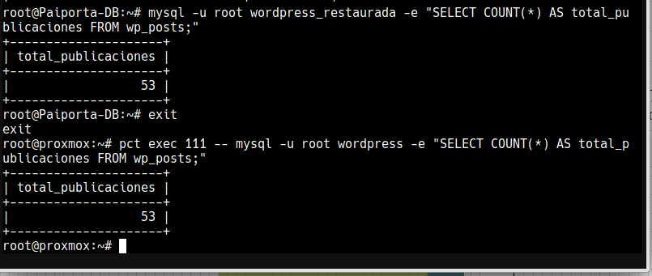

# Práctica 5a. Backup y restauración de una base de datos MySQL

## 1. Objetivo

El objetivo de esta práctica es realizar una copia de seguridad de una base de datos MySQL y restaurarla en otro entorno.

Para ello, utilizamos la base de datos de nuestro proyecto **Compra Paiporta**, creado con WordPress en Proxmox.

## 3. Comprobación de MySQL

Primero comprobamos que MySQL funcionaba en el contenedor de origen.

Desde la Shell de Proxmox ejecutamos:

pct exec 111 -- mysql -u root -e "SELECT VERSION(); SHOW DATABASES;"

Comprobamos que teníamos instalado MySQL 8.4.11 y que existía la base de datos `wordpress`.

También iniciamos el contenedor 105 y comprobamos que tenía la misma versión de MySQL.

    pct status 105
    pct exec 105 -- mysql --version

## 4. Creación del backup

Entramos en el contenedor 111:

    pct enter 111

Creamos un directorio privado para guardar las copias:

    umask 077
    mkdir -p /root/backups-mysql
    chmod 700 /root/backups-mysql

Después generamos el backup de la base de datos WordPress:

    FECHA="$(date '+%F_%H%M%S')"
    ARCHIVO="/root/backups-mysql/wordpress-${FECHA}.sql"

    mysqldump -u root \
      --single-transaction --quick --hex-blob \
      --default-character-set=utf8mb4 \
      --no-create-db --add-drop-table \
      --routines --events \
      wordpress > "$ARCHIVO" && test -s "$ARCHIVO"

Con este comando realizamos una copia lógica de las tablas y los datos de WordPress.

El archivo generado fue:

    wordpress-2026-11-13_144228.sql

Su tamaño aproximado era de **1,2 MB**.

## 5. Verificación del backup

Comprobamos que el archivo existía y calculamos su hash SHA-256:

    ls -lh "$ARCHIVO"
    sha256sum "$ARCHIVO"

El hash nos permite comprobar que el archivo no se modifica durante la transferencia.

También verificamos que los permisos del archivo eran `600`, por lo que únicamente su propietario podía leerlo y modificarlo.
- 

## 6. Transferencia al contenedor de destino

Para trasladar el backup utilizamos Proxmox como intermediario.

Primero copiamos el archivo del contenedor 111 al servidor Proxmox:

    pct pull 111 /root/backups-mysql/wordpress-2026-11-13_144228.sql /root/wordpress-2026-11-13_144228.sql

Después preparamos el directorio en el contenedor 105:

    pct exec 105 -- mkdir -p /root/backups-mysql
    pct exec 105 -- chmod 700 /root/backups-mysql

Copiamos el archivo al contenedor de destino:

    pct push 105 /root/wordpress-2026-11-13_144228.sql /root/backups-mysql/wordpress-2026-11-13_144228.sql

Finalmente, comprobamos el hash SHA-256 del archivo recibido:

    pct exec 105 -- sha256sum /root/backups-mysql/wordpress-2026-11-13_144228.sql

Los hashes del origen y del destino coincidían, por lo que confirmamos que el archivo se había transferido correctamente.
- 

## 7. Creación de la base de datos de destino

Entramos en el contenedor 105:

    pct enter 105

Accedimos a MySQL:

    mysql -u root

Creamos una base nueva para no modificar la base de datos existente de Paiporta Arbolado:

    CREATE DATABASE wordpress_restaurada
    CHARACTER SET utf8mb4 COLLATE utf8mb4_unicode_ci;

Comprobamos su creación:

    SHOW DATABASES;

La base `wordpress_restaurada` aparecía correctamente.

- 

## 8. Restauración del backup

Salimos de MySQL y ejecutamos la importación del archivo SQL en la nueva base:

    mysql -u root wordpress_restaurada < /root/backups-mysql/wordpress-2026-11-13_144228.sql

Después comprobamos que las tablas se habían restaurado:

    mysql -u root -e "SHOW TABLES FROM wordpress_restaurada;"

El resultado mostró las **12 tablas de WordPress**, entre ellas:

- wp_posts
- wp_users
- wp_options
- wp_comments
- wp_postmeta

Por tanto, comprobamos que la estructura de la base de datos se había recuperado.
- 

## 9. Comprobación de los datos

Para verificar que también se habían restaurado los contenidos, ejecutamos:

    mysql -u root wordpress_restaurada -e "SELECT post_title, post_type FROM wp_posts WHERE post_status='publish' AND post_type IN ('page','post');"

En el resultado aparecían las páginas y publicaciones que habíamos creado en Compra Paiporta:

- INICIO
- Comercio
- Cupones
- Eventos
- Ayuda
- Contacto
- Mi perfil
- Novedades del sitio
- Panadería El Forn de Paiporta
- Floristería La Plaça

Esto demuestra que no solamente se restauraron las tablas, sino también los datos.
- 

## 10. Comparación entre origen y destino

Finalmente, comprobamos el número de registros de la tabla `wp_posts` en ambas bases de datos.

En el contenedor 105:

    mysql -u root wordpress_restaurada -e "SELECT COUNT(*) AS total_publicaciones FROM wp_posts;"

Después, desde Proxmox, consultamos la base de datos original del contenedor 111:

    pct exec 111 -- mysql -u root wordpress -e "SELECT COUNT(*) AS total_publicaciones FROM wp_posts;"

Los resultados fueron:

| Base de datos | Registros en wp_posts |
|---|---:|
| wordpress (origen) | 53 |
| wordpress_restaurada (destino) | 53 |

Ambas bases contenían **53 registros en la tabla `wp_posts`**.

Por tanto, confirmamos que los registros de esta tabla coincidían en cantidad.

- 

## 11. Observaciones

En esta práctica hemos utilizado los comandos `pct pull` y `pct push` de Proxmox para transferir el archivo entre contenedores, en lugar de SCP/SFTP.

Además, el contenedor 105 únicamente dispone del servidor MySQL. Por tanto, hemos comprobado la restauración de la base de datos, pero no el funcionamiento completo de WordPress en el destino.

La base de datos original de Paiporta Arbolado no se ha modificado.

## 12. Conclusión

En esta práctica hemos aprendido a realizar un backup de MySQL utilizando `mysqldump`, verificar su integridad mediante SHA-256 y restaurarlo en otro contenedor de Proxmox.

También hemos comprobado que las tablas y los contenidos de WordPress se han recuperado correctamente.

La restauración se realizó en una base nueva para evitar modificar las bases de datos existentes.

Finalmente, comprobamos que la tabla `wp_posts` contenía **53 registros tanto en el origen como en el destino**, confirmando que la cantidad de registros coincidía.

# Práctica 5b. Backup con TAR

## 1. Objetivo

El objetivo de esta práctica es realizar copias de seguridad de los archivos web y de la base de datos de **Paiporta Arbolado**.

Para ello utilizamos:

- **tar:** para comprimir y guardar los archivos de la web.
- **mysqldump:** para realizar una copia de la base de datos.
- **cron:** para automatizar las copias de seguridad.

También estudiamos cómo restaurar los datos en caso de fallo.

## 2. Entorno utilizado

Trabajamos con los dos contenedores LXC que ya teníamos creados en Proxmox.

| Contenedor | IP | Función |
|---|---|---|
| 104 - Paiporta-web | 192.168.30.10 | Apache, PHP y aplicación web |
| 105 - Paiporta-DB | 192.168.30.11 | Servidor MySQL |

Comprobamos que:

- Los archivos de la web estaban en `/var/www/html`.
- La base de datos se llamaba `PaiportArbolado`.
- Ambos contenedores podían comunicarse.

## 3. Preparación del directorio de backups

Entramos en el contenedor web desde Proxmox:

    pct enter 104

Creamos una carpeta para almacenar las copias de seguridad:

    mkdir -p /BACKUPS/paiportarbolado
    chmod 700 /BACKUPS
    chmod 700 /BACKUPS/paiportarbolado

Comprobamos sus permisos:

    ls -ld /BACKUPS/paiportarbolado

Guardamos las copias fuera del directorio público de Apache para evitar que puedan descargarse desde la web.

## 4. Configuración de acceso a MySQL

Desde el contenedor 104 comprobamos que podíamos conectarnos a la base de datos del contenedor 105:

    mysql -h 192.168.30.11 -u paiporta -p -e "SHOW DATABASES;"

Como el script se ejecutará automáticamente, necesitamos que MySQL no solicite la contraseña de forma interactiva.

Creamos el archivo:

    nano /root/.my.cnf

Contenido de ejemplo:

    [client]
    host=192.168.30.11
    user=paiporta
    password="CONTRASEÑA_DE_PRUEBA"

Protegimos el archivo:

    chmod 600 /root/.my.cnf

Comprobamos la conexión:

    mysql --defaults-extra-file=/root/.my.cnf -e "SHOW DATABASES;"

La conexión funcionó correctamente.

## 5. Creación del script de backup

Creamos el script:

    nano /usr/local/sbin/backup-paiporta.sh

Introdujimos el siguiente contenido:

    #!/bin/bash
    set -euo pipefail
    umask 077

    SOURCE="/var/www/html"
    BACKUP_DIR="/BACKUPS/paiportarbolado"
    DB_NAME="PaiportArbolado"
    DB_CONFIG="/root/.my.cnf"
    FECHA=$(date +%F_%H-%M-%S)

    DB_BACKUP="$BACKUP_DIR/paiportarbolado-db-$FECHA.sql"
    WEB_BACKUP="$BACKUP_DIR/paiportarbolado-web-$FECHA.tar.gz"

    if [ ! -d "$SOURCE" ]; then
        echo "Error: no existe el directorio web."
        exit 1
    fi

    if [ ! -f "$DB_CONFIG" ]; then
        echo "Error: no existe la configuración de MySQL."
        exit 1
    fi

    mkdir -p "$BACKUP_DIR"

    mysqldump --defaults-extra-file="$DB_CONFIG" \
        --single-transaction --quick --no-tablespaces \
        "$DB_NAME" > "$DB_BACKUP"

    tar -czf "$WEB_BACKUP" -C "$SOURCE" .

    echo "Copias creadas correctamente: $FECHA"

El script realiza dos operaciones:

1. Genera un archivo `.sql` con la base de datos.
2. Genera un archivo `.tar.gz` con los archivos de la web.

Ambos archivos utilizan la misma fecha y hora para identificarlos.

Después configuramos los permisos:

    chown root:root /usr/local/sbin/backup-paiporta.sh
    chmod 750 /usr/local/sbin/backup-paiporta.sh

## 6. Comprobación del backup

Volvimos a ejecutar:

    /usr/local/sbin/backup-paiporta.sh

Esta vez terminó correctamente.

Comprobamos los archivos generados:

    ls -lh /BACKUPS/paiportarbolado/

Se crearon dos archivos:

- `paiportarbolado-db-2026-11-17_17-45-43.sql` (3,2 KB).
- `paiportarbolado-web-2026-11-17_17-45-43.tar.gz` (2,1 MB).

Los dos tenían la misma fecha y hora.

Los archivos SQL de 0 bytes de los intentos anteriores no se consideran copias válidas.

## 8. Automatización con cron

Para realizar las copias automáticamente, configuramos una tarea programada.

Abrimos el crontab del usuario root:

    crontab -e

Añadimos la siguiente línea:

    0 2 * * * /usr/local/sbin/backup-paiporta.sh >> /var/log/backup-paiporta.log 2>&1

Esta configuración ejecuta el script **todos los días a las 02:00**.

El resultado de cada ejecución se guarda en:

    /var/log/backup-paiporta.log

Comprobamos la programación:

    crontab -l

## 9. Prueba de ejecución automática

Para comprobar que cron funcionaba sin esperar hasta las 02:00, realizamos una prueba.

Primero configuramos la zona horaria del contenedor:

    timedatectl set-timezone Europe/Madrid

Después añadimos temporalmente una tarea para las 18:55:

    55 18 * * * /usr/local/sbin/backup-paiporta.sh >> /var/log/backup-paiporta.log 2>&1

Comprobamos que cron ejecutó el script y generó nuevos archivos de backup.

Revisamos los archivos y el registro:

    ls -lh /BACKUPS/paiportarbolado/

    tail -n 10 /var/log/backup-paiporta.log

La prueba funcionó correctamente.

Finalmente, eliminamos la línea temporal de las 18:55 y dejamos únicamente la programación diaria de las 02:00.
7
## 10. Simulación de restauración con TAR

El enunciado pide realizar una restauración en clones aislados de los contenedores.

Para evitar modificar los contenedores originales, estudiamos el procedimiento de restauración mediante una simulación de comandos.

**Esta restauración no se ha ejecutado realmente.**

### 10.1. Localizar las copias

En el clon web:

    ls -lh /BACKUPS/paiportarbolado/

Seleccionamos el archivo `.tar.gz` y el archivo `.sql` que tengan la misma fecha.

Definimos las variables:

    FECHA="FECHA_DEL_BACKUP"
    SOURCE="/var/www/html"
    DB_NAME="PaiportArbolado"

    WEB_BACKUP="/BACKUPS/paiportarbolado/paiportarbolado-web-$FECHA.tar.gz"
    DB_BACKUP="/BACKUPS/paiportarbolado/paiportarbolado-db-$FECHA.sql"

### 10.2. Simular la pérdida de los archivos

En el clon web, detenemos Apache:

    systemctl stop apache2

Apartamos los archivos originales:s

    mv "$SOURCE" "${SOURCE}.fallo-$FECHA"
    mkdir -p "$SOURCE"

### 10.3. Restaurar los archivos web

Utilizamos TAR para recuperar los archivos:

    tar -xzf "$WEB_BACKUP" -C "$SOURCE"

Comprobamos el resultado:

    ls -lah /var/www/html/

El comando `tar -xzf` extrae los archivos del backup y los restaura en el directorio indicado.

### 10.4. Restaurar la base de datos

En el clon de MySQL, eliminamos únicamente la base de datos de prueba y la creamos vacía:

    DROP DATABASE PaiportArbolado;

    CREATE DATABASE PaiportArbolado
    CHARACTER SET utf8mb4 COLLATE utf8mb4_unicode_ci;

Después importamos el archivo SQL desde el clon web:

    mysql -h IP_PRIVADA_DB_CLON -u USUARIO_RESTAURACION -p \
      PaiportArbolado < "$DB_BACKUP"

Comprobamos que las tablas se han restaurado:

    mysql -h IP_PRIVADA_DB_CLON -u USUARIO_RESTAURACION -p \
      -e "SHOW TABLES FROM PaiportArbolado;"

### 10.5. Recuperar el servicio

Antes de iniciar la aplicación, debemos comprobar que su configuración apunta a la base de datos clonada.

Después iniciamos Apache:

    apache2ctl configtest
    systemctl start apache2
    systemctl status apache2

Finalmente, accederíamos a la aplicación desde el navegador para comprobar que se han recuperado los registros y las imágenes.

## 11. Comandos importantes para el examen

### Crear un backup con TAR

    tar -czf backup.tar.gz -C /var/www/html .

### Restaurar un backup con TAR

    tar -xzf backup.tar.gz -C /var/www/html

### Mostrar el contenido de un TAR sin extraerlo

    tar -tzf backup.tar.gz

### Crear un backup de MySQL

    mysqldump -u usuario -p --no-tablespaces basedatos > backup.sql

### Restaurar una base de datos MySQL

    mysql -u usuario -p basedatos < backup.sql

### Programar una copia diaria a las 02:00

    0 2 * * * /ruta/script.sh

**Opciones de TAR:**

- `c`: crear archivo.
- `x`: extraer archivo.
- `z`: comprimir o descomprimir con gzip.
- `f`: indicar el archivo.
- `t`: listar el contenido.
- `C`: cambiar al directorio indicado.

## 12. Conclusión

En esta práctica hemos aprendido a realizar copias de seguridad de una aplicación web utilizando TAR y mysqldump.

Creamos un script que genera automáticamente dos archivos: uno con los datos de MySQL y otro con los archivos de la web.

También configuramos cron para ejecutar el backup diariamente a las 02:00 y comprobamos su funcionamiento mediante una ejecución programada de prueba.

Por último, estudiamos el procedimiento para restaurar los archivos y la base de datos en caso de fallo.

**Estado de la práctica:**

- Backup completo: realizado.
- Ejecución manual: comprobada.
- Automatización con cron: comprobada.
- Restauración en clones: documentada, pendiente de ejecución.
- Copias incrementales: ampliación opcional no realizada.
