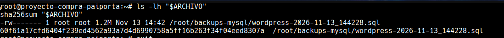
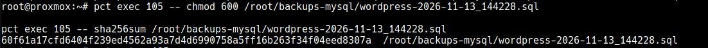
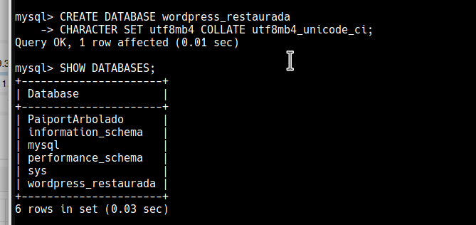
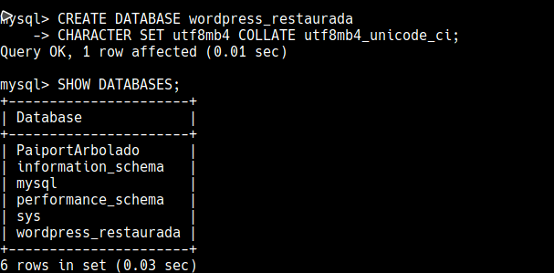
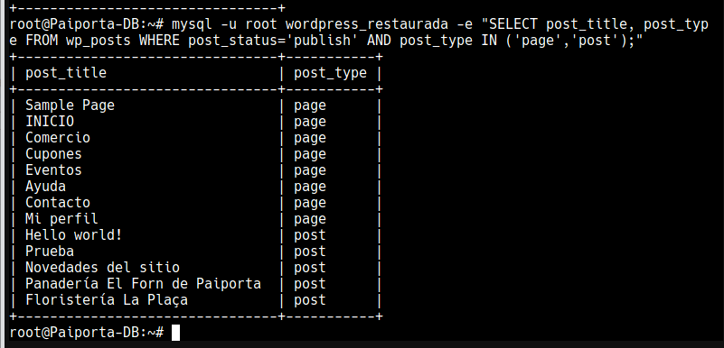

# Práctica 5a. Backup y restauración de una base de datos MySQL

## 1. Objetivo

El objetivo de esta práctica es realizar una copia de seguridad de una base de datos MySQL y restaurarla en otro entorno.

Para ello, utilizamos la base de datos de nuestro proyecto **Compra Paiporta**, creado con WordPress en Proxmox.

## 3. Comprobación de MySQL

Primero comprobamos que MySQL funcionaba en el contenedor de origen.

Desde la Shell de Proxmox ejecutamos:

pct exec 111 -- mysql -u root -e "SELECT VERSION(); SHOW DATABASES;"

Comprobamos que teníamos instalado MySQL 8.4.11 y que existía la base de datos `wordpress`.

También iniciamos el contenedor 105 y comprobamos que tenía la misma versión de MySQL.

    pct status 105
    pct exec 105 -- mysql --version

## 4. Creación del backup

Entramos en el contenedor 111:

    pct enter 111

Creamos un directorio privado para guardar las copias:

    umask 077
    mkdir -p /root/backups-mysql
    chmod 700 /root/backups-mysql

Después generamos el backup de la base de datos WordPress:

    FECHA="$(date '+%F_%H%M%S')"
    ARCHIVO="/root/backups-mysql/wordpress-${FECHA}.sql"

    mysqldump -u root \
      --single-transaction --quick --hex-blob \
      --default-character-set=utf8mb4 \
      --no-create-db --add-drop-table \
      --routines --events \
      wordpress > "$ARCHIVO" && test -s "$ARCHIVO"

Con este comando realizamos una copia lógica de las tablas y los datos de WordPress.

El archivo generado fue:

    wordpress-2026-11-13_144228.sql

Su tamaño aproximado era de **1,2 MB**.

## 5. Verificación del backup

Comprobamos que el archivo existía y calculamos su hash SHA-256:

    ls -lh "$ARCHIVO"
    sha256sum "$ARCHIVO"

El hash nos permite comprobar que el archivo no se modifica durante la transferencia.

También verificamos que los permisos del archivo eran `600`, por lo que únicamente su propietario podía leerlo y modificarlo.
- 

## 6. Transferencia al contenedor de destino

Para trasladar el backup utilizamos Proxmox como intermediario.

Primero copiamos el archivo del contenedor 111 al servidor Proxmox:

    pct pull 111 /root/backups-mysql/wordpress-2026-11-13_144228.sql /root/wordpress-2026-11-13_144228.sql

Después preparamos el directorio en el contenedor 105:

    pct exec 105 -- mkdir -p /root/backups-mysql
    pct exec 105 -- chmod 700 /root/backups-mysql

Copiamos el archivo al contenedor de destino:

    pct push 105 /root/wordpress-2026-11-13_144228.sql /root/backups-mysql/wordpress-2026-11-13_144228.sql

Finalmente, comprobamos el hash SHA-256 del archivo recibido:

    pct exec 105 -- sha256sum /root/backups-mysql/wordpress-2026-11-13_144228.sql

Los hashes del origen y del destino coincidían, por lo que confirmamos que el archivo se había transferido correctamente.
- 

## 7. Creación de la base de datos de destino

Entramos en el contenedor 105:

    pct enter 105

Accedimos a MySQL:

    mysql -u root

Creamos una base nueva para no modificar la base de datos existente de Paiporta Arbolado:

    CREATE DATABASE wordpress_restaurada
    CHARACTER SET utf8mb4 COLLATE utf8mb4_unicode_ci;

Comprobamos su creación:

    SHOW DATABASES;

La base `wordpress_restaurada` aparecía correctamente.

- 

## 8. Restauración del backup

Salimos de MySQL y ejecutamos la importación del archivo SQL en la nueva base:

    mysql -u root wordpress_restaurada < /root/backups-mysql/wordpress-2026-11-13_144228.sql

Después comprobamos que las tablas se habían restaurado:

    mysql -u root -e "SHOW TABLES FROM wordpress_restaurada;"

El resultado mostró las **12 tablas de WordPress**, entre ellas:

- wp_posts
- wp_users
- wp_options
- wp_comments
- wp_postmeta

Por tanto, comprobamos que la estructura de la base de datos se había recuperado.
- 

## 9. Comprobación de los datos

Para verificar que también se habían restaurado los contenidos, ejecutamos:

    mysql -u root wordpress_restaurada -e "SELECT post_title, post_type FROM wp_posts WHERE post_status='publish' AND post_type IN ('page','post');"

En el resultado aparecían las páginas y publicaciones que habíamos creado en Compra Paiporta:

- INICIO
- Comercio
- Cupones
- Eventos
- Ayuda
- Contacto
- Mi perfil
- Novedades del sitio
- Panadería El Forn de Paiporta
- Floristería La Plaça

Esto demuestra que no solamente se restauraron las tablas, sino también los datos.
- 

## 10. Comparación entre origen y destino

Finalmente, comprobamos el número de registros de la tabla `wp_posts` en ambas bases de datos.

En el contenedor 105:

    mysql -u root wordpress_restaurada -e "SELECT COUNT(*) AS total_publicaciones FROM wp_posts;"

Después, desde Proxmox, consultamos la base de datos original del contenedor 111:

    pct exec 111 -- mysql -u root wordpress -e "SELECT COUNT(*) AS total_publicaciones FROM wp_posts;"

Los resultados fueron:

| Base de datos | Registros en wp_posts |
|---|---:|
| wordpress (origen) | 53 |
| wordpress_restaurada (destino) | 53 |

Ambas bases contenían **53 registros en la tabla `wp_posts`**.

Por tanto, confirmamos que los registros de esta tabla coincidían en cantidad.

- 

## 11. Observaciones

En esta práctica hemos utilizado los comandos `pct pull` y `pct push` de Proxmox para transferir el archivo entre contenedores, en lugar de SCP/SFTP.

Además, el contenedor 105 únicamente dispone del servidor MySQL. Por tanto, hemos comprobado la restauración de la base de datos, pero no el funcionamiento completo de WordPress en el destino.

La base de datos original de Paiporta Arbolado no se ha modificado.

## 12. Conclusión

En esta práctica hemos aprendido a realizar un backup de MySQL utilizando `mysqldump`, verificar su integridad mediante SHA-256 y restaurarlo en otro contenedor de Proxmox.

También hemos comprobado que las tablas y los contenidos de WordPress se han recuperado correctamente.

La restauración se realizó en una base nueva para evitar modificar las bases de datos existentes.

Finalmente, comprobamos que la tabla `wp_posts` contenía **53 registros tanto en el origen como en el destino**, confirmando que la cantidad de registros coincidía.
