Florencia Oribe.

# Práctica 1:

## Práctica 1a: Instalación de un Proxmox


## Objetivo

El objetivo de esta práctica es instalar y configurar Proxmox VE en una máquina virtual creada con VirtualBox.

Durante la práctica configuraremos la red, comprobaremos la conectividad, actualizaremos el sistema e instalaremos el certificado de la autoridad certificadora (CA) de Proxmox en nuestro equipo Linux.

### 1. Creación de la máquina virtual

Descargamos la imagen ISO de Proxmox VE desde su página oficial y creamos una máquina virtual en VirtualBox con los recursos requeridos para la práctica.
- 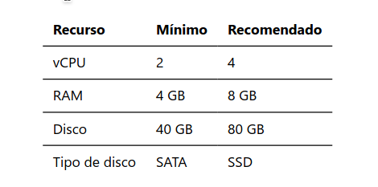

Configuramos el adaptador de red de la máquina virtual utilizando la red NAT solicitada.
La red NAT permite que la máquina virtual utilice la conexión del equipo anfitrión para comunicarse con otras redes.

- 


### 2. Proceso de Instalación
Durante el proceso configuramos los siguientes parámetros:
- **Hostname: proxmox.local**
- **Dirección IP: 10.0.2.3/24**
- **Puerta de enlace: 10.0.2.1**
- **DNS: 1.1.1.1**

*Dato importante: despues de configurar la instalación tenemos que quitar la iso de la vm porque si no, cada rato intentara leerla y no funcionara.*
Comprobamos el hostname, si la ip es correcta y la version de PROXMOX:
- 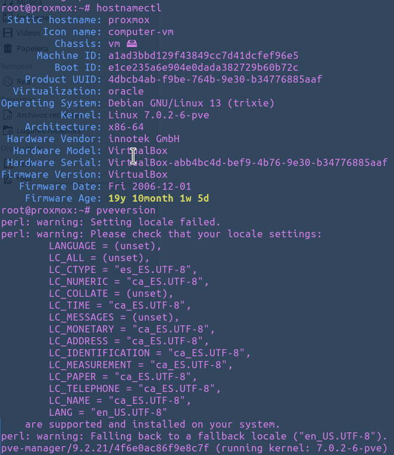
- 

- Comprobamos si tenemos conexión via ssh.
- 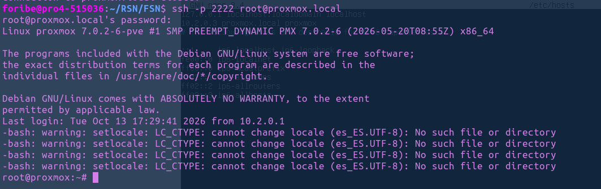


### 3. Acceso a la interfaz web

Proxmox dispone de una interfaz web de administración que utiliza el protocolo HTTPS y el puerto 8006.

Accedemos mediante la dirección:

*https://proxmox.local:8006*

Para que el acceso funcione, el nombre proxmox.local debe resolverse correctamente desde nuestro equipo y debe existir conectividad con el servidor.
- 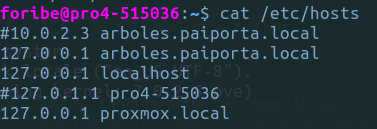

Desde la interfaz web podemos administrar el nodo, gestionar máquinas virtuales, configurar almacenamiento y consultar el estado del sistema.


- 


### 4. Configuración de repositorios

Para arreglar los repositorios tuveimos que deshabilitar (comentando) el pve-enterprise.sources y añadir **pve-no-subscription.sources**:
```bash 
Types: deb
URIs: http://download.proxmox.com/debian/pve
Suites: trixie
Components: pve-no-subscription
Signed-By: /usr/share/keyrings/proxmox-archive-keyring.gpg
```
Luego de esto, ya podemos actualizar el Proxmox.
- 
Comprobamos desde la interfaz web que no hay mas actualizaciones.
- 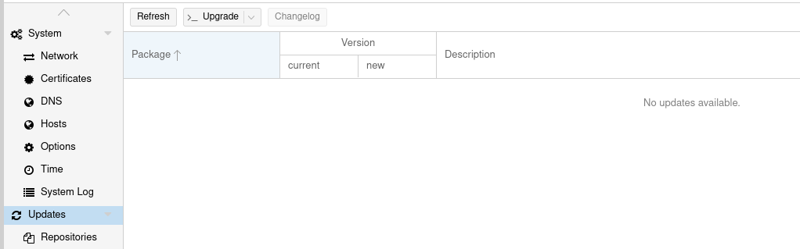


### 5. Instalación del certificado de la CA
Ejecutamos el siguiente comando para visualizar el certificado:

```bash
cat /etc/pve/pve-root-ca.pem
```
- 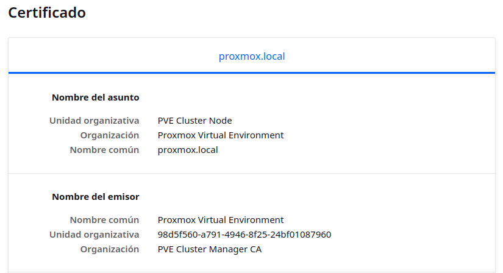
Copiamos todo el contenido que aparece y creamos un fichero de texto donde pegamos el contenido copiado.
Guardamos el archivo con el nombre:

**pve-root-ca.crt**

Para verificar que el certificado copiado es el mismo que tiene Proxmox, ejecutamos en el servidor:

```bash
openssl x509 -in /etc/pve/pve-root-ca.pem -noout -fingerprint -sha256
```

- 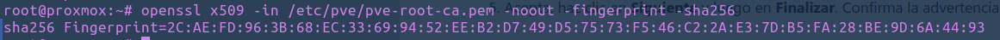

En nuestro equipo Linux, desde la carpeta donde hemos guardado el certificado, ejecutamos:

```bash
openssl x509 -in pve-root-ca.crt -noout -fingerprint -sha256
```
- 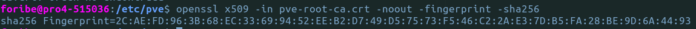


#### Importamos el certificado: 
Abrimos Firefox y accedemos a:

Ajustes → Privacidad y seguridad → Certificados → Ver certificados → Autoridades → Importar

Seleccionamos el archivo pve-root-ca.crt que hemos guardado anteriormente.

- 


### Conclusión

En esta práctica hemos realizado la instalación y configuración inicial de Proxmox VE en una máquina virtual utilizando VirtualBox.

Hemos configurado la red NAT, comprobado la conectividad mediante SSH, preparado los repositorios sin suscripción y actualizado el sistema.

Además, hemos obtenido el certificado de la autoridad certificadora de Proxmox, comprobado su huella SHA-256 e importado el certificado en Firefox.

Con estos pasos hemos preparado un entorno de virtualización para administrar máquinas virtuales y contenedores desde Proxmox.


# Práctica 1b - Redundancia y almacenamiento en PROXMOX

## ZFS con mirror
Creamos dos discos duros virtuales de 50GB.
- 

Creamos el mirror de zfs llamado *pve-storage*
```bash
zpool create -o ashift=12 pve-storage mirror /dev/sdb /dev/sdc
```

Comprobamos estado y capacidad:
- 

Creamos el pool desde la interfaz web con los siguientes datos:

```text
ID: zfs-lab
ZFS Pool: pve-storage
Content: Disk image y, si se crearán contenedores, Container (rootdir)
Node: el nodo actual
Activa Thin provision si aparece en el formulario
```

- 


## RAID 1 con mdadm
1. Identificamos los dos discos de laboratorio:

```bash
lsblk -o NAME,SIZE,TYPE,FSTYPE,MOUNTPOINTS,MODEL
```

2. Creamos el array RAID 1 con los dispositivos de laboratorio correctos:
```bash
mdadm --create /dev/md0 --level=1 --raid-devices=2 /dev/sdb /dev/sdc
```
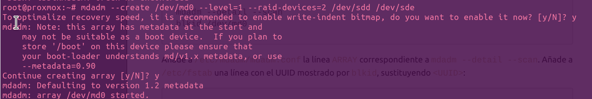


3. Comprobamos el estado:
```bash
mdadm --detail /dev/md0
cat /proc/mdstat
```
Que estado tiene el md0.

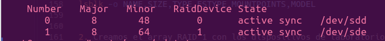


Hemos creado un array de disco y lo hemos registrado en proxmox. Para que cuando arranque lo idnentifique como arranque de disco..
Añadiendo el array 
ARRAY /dev/md0 metadata=1.2 UUID=5f70d22b:d6b111b6:7e758936:0305b089
al fichero /etc/mdadm/mdadm.conf

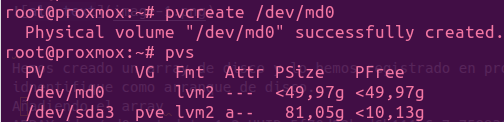

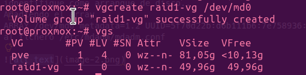


- 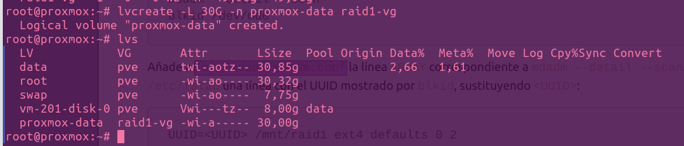

- 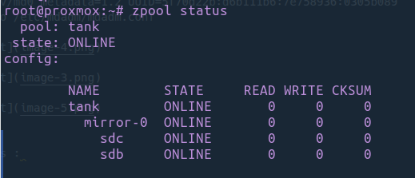
- 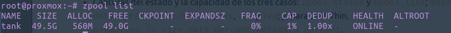
- 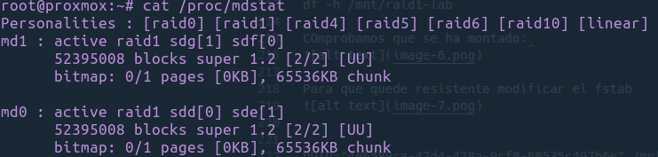

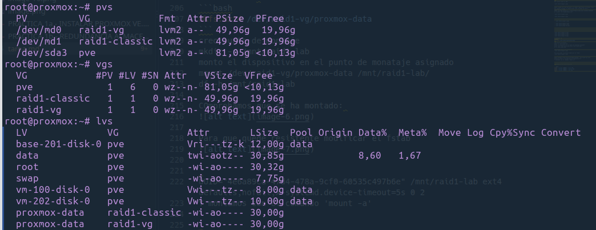


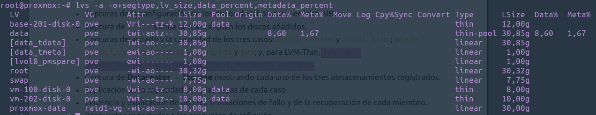

formatemos : 
```bash
mkfs.ext4 /dev/raid1-vg/proxmox-data
```
creo punto de montaje
mkdir -p /mnt/raid1-lab
monto el dispositivo en el punto de monataje asignado
mount /dev/raid1-vg/proxmox-data /mnt/raid1-lab/
df -h /mnt/raid1-lab

COmprobamos que se ha montado: 
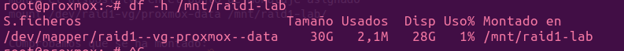

Para que quede resistente modificar el fstab
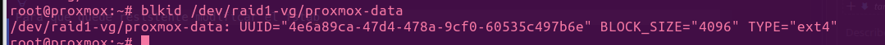


UUID="4e6a89ca-47d4-478a-9cf0-60535c497b6e" /mnt/raid1-lab ext4 defaults,nofail,x-systemd.device-timeout=5s 0 2
Y montamos con el comando 'mount -a'


4. Simulación de fallo de disco

```bash
mdadm --manage <ARRAY> --fail sdd
mdadm --manage <ARRAY> --remove sdd
mdadm --manage <ARRAY> --add sdd
```


Verifica que sigue activo en estado degradado:
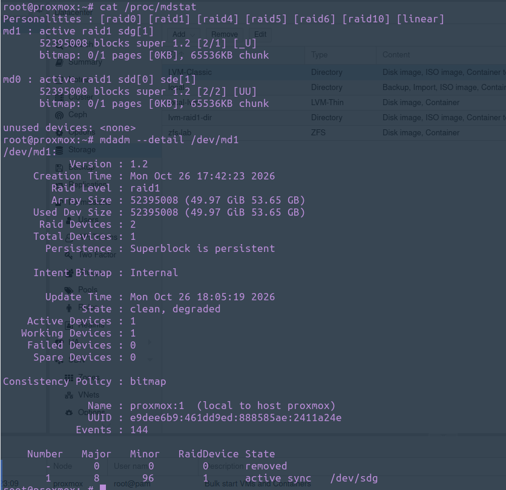

- Incoroportamos neuvamente el disco.
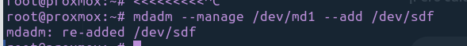


 Conclusión técnica
ZFS mirror y mdadm RAID1 mantienen el servicio ante la caída de un miembro, pero no sustituyen a las
copias de seguridad: fallos del sistema, corrupción o errores humanos aún pueden exigir una restauración.
Elige según la gestión, recuperación, snapshots y compatibilidad que necesite el escenario.
10. Reflexión y preguntas
Responde con tus propias palabras:
1. ¿Qué diferencia existe entre un volumen lógico y un sistema de archivos?
2. ¿Qué ventajas tiene RAID 1 frente a RAID 0?
3. ¿Por qué la redundancia no sustituye a las copias de seguridad?
4. ¿Qué función tiene un zpool en ZFS?
5. ¿Qué diferencia existe entre un dataset y un zvol?
6. ¿Qué es un mirror y qué fallo puede tolerar el mirror de dos discos de esta práctica?
7. ¿Qué diferencia hay entre LVM-Thin y ZFS a la hora de almacenar discos de VM?
8. ¿Por qué LVM no aporta redundancia por sí solo?
9. ¿Qué diferencia existe entre el RAID gestionado por mdadm y un mirror ZFS?
10. ¿Qué información aporta el estado del array o del pool después de simular un fallo?
11. ¿Qué representa el disco virtual que ve la VM y qué capas puede crear dentro de él?
12. ¿Qué ventajas y riesgos tiene el aprovisionamiento thin? ¿Qué indican Data% y Meta%?
13. ¿Qué capas comparten los casos 2 y 3, y en qué se diferencian a partir del VG?
11. Entrega
La entrega debe incluir, como mínimo:
Capturas de la configuración de los discos de laboratorio en VirtualBox.
Captura de lsblk donde se identifiquen los discos añadidos.
Capturas del estado y la capacidad de los tres casos: zpool status y zpool list; mdadm --
detail, cat /proc/mdstat, pvs, vgs y lvs; y, para LVM-Thin, lvs -a -
o+segtype,lv_size,data_percent,metadata_percent.
Captura de Datacenter → Storage mostrando cada uno de los tres almacenamientos registrados.
Explicación de la capacidad útil y las capas de cada caso.
Evidencia y explicación de las tres simulaciones de fallo y de la recuperación de cada miembro.
Respuestas redactadas a las preguntas de reflexión.
Conclusión sobre qué tecnología resulta más útil para el escenario estudiado y por qué.


# PRÁCTICA 1C - COMPARACIÓN DE ALMACENAMIENTO CON LXC EN PROXMOX

2. Objetivos de la práctica
Crear y configurar un contenedor LXC en Proxmox.
Comparar rendimiento, consumo de recursos (CPU y RAM) y facilidad de gestión.
Comparar el rendimiento y la gestión de ZFS, LVM clásico y LVM-Thin para rootfs de LXC.


3. Medicion
ya cree un contenedor