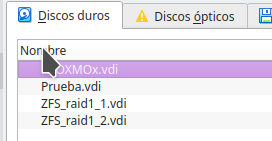
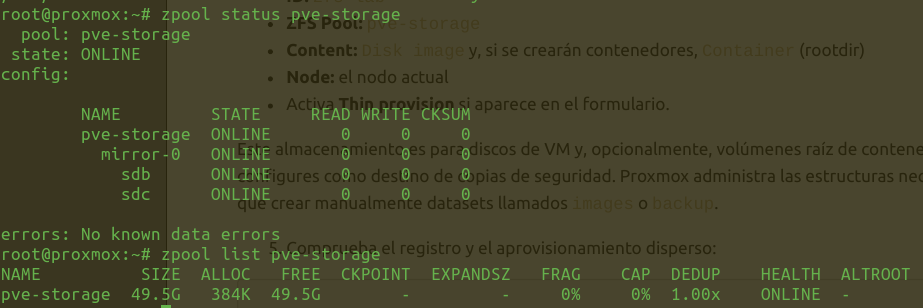
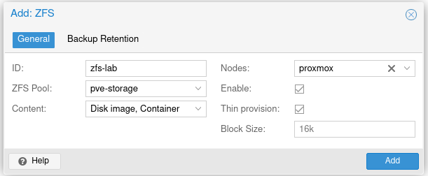

Florencia Oribe


# PRÁCTICA 1B - REDUNDANCIA Y ALMACENAMIENTO EN PROXMOX

## ZFS con mirror
Creamos dos discos duros virtuales de 50GB.
- 

Creamos el mirror de zfs llamado *pve-storage*
```bash
zpool create -o ashift=12 pve-storage mirror /dev/sdb /dev/sdc
```

Comprobamos estado y capacidad:
- 

Creamos el pool desde la interfaz web con los siguientes datos:

```text
ID: zfs-lab
ZFS Pool: pve-storage
Content: Disk image y, si se crearán contenedores, Container (rootdir)
Node: el nodo actual
Activa Thin provision si aparece en el formulario
```

- 