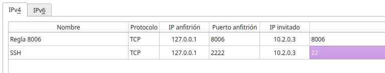
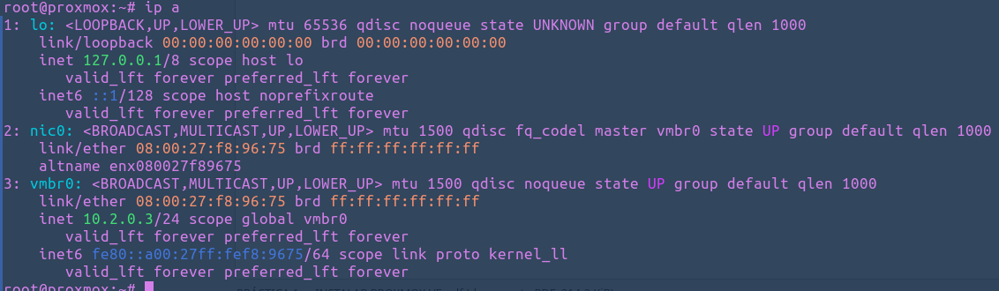
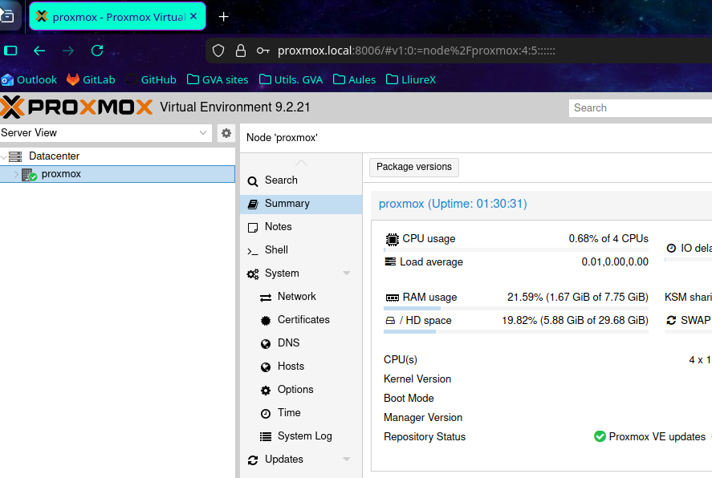
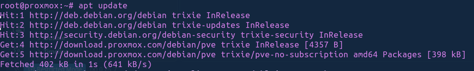

Florencia Oribe.

# Práctica: Instalación de un Proxmox


## Objetivo

El objetivo de esta práctica es instalar y configurar Proxmox VE en una máquina virtual creada con VirtualBox.

Durante la práctica configuraremos la red, comprobaremos la conectividad, actualizaremos el sistema e instalaremos el certificado de la autoridad certificadora (CA) de Proxmox en nuestro equipo Linux.

### 1. Creación de la máquina virtual

Descargamos la imagen ISO de Proxmox VE desde su página oficial y creamos una máquina virtual en VirtualBox con los recursos requeridos para la práctica.
- 

Configuramos el adaptador de red de la máquina virtual utilizando la red NAT solicitada.
La red NAT permite que la máquina virtual utilice la conexión del equipo anfitrión para comunicarse con otras redes.

- 


### 2. Proceso de Instalación
Durante el proceso configuramos los siguientes parámetros:
- **Hostname: proxmox.local**
- **Dirección IP: 10.0.2.3/24**
- **Puerta de enlace: 10.0.2.1**
- **DNS: 1.1.1.1**

*Dato importante: despues de configurar la instalación tenemos que quitar la iso de la vm porque si no, cada rato intentara leerla y no funcionara.*
Comprobamos el hostname, si la ip es correcta y la version de PROXMOX:
- 
- 

- Comprobamos si tenemos conexión via ssh.
- 


### 3. Acceso a la interfaz web

Proxmox dispone de una interfaz web de administración que utiliza el protocolo HTTPS y el puerto 8006.

Accedemos mediante la dirección:

*https://proxmox.local:8006*

Para que el acceso funcione, el nombre proxmox.local debe resolverse correctamente desde nuestro equipo y debe existir conectividad con el servidor.
- 

Desde la interfaz web podemos administrar el nodo, gestionar máquinas virtuales, configurar almacenamiento y consultar el estado del sistema.


- 


### 4. Configuración de repositorios

Para arreglar los repositorios tuveimos que deshabilitar (comentando) el pve-enterprise.sources y añadir **pve-no-subscription.sources**:
```bash 
Types: deb
URIs: http://download.proxmox.com/debian/pve
Suites: trixie
Components: pve-no-subscription
Signed-By: /usr/share/keyrings/proxmox-archive-keyring.gpg
```
Luego de esto, ya podemos actualizar el Proxmox.
- 
Comprobamos desde la interfaz web que no hay mas actualizaciones.
- 


### 5. Instalación del certificado de la CA
Ejecutamos el siguiente comando para visualizar el certificado:

```bash
cat /etc/pve/pve-root-ca.pem
```
- 
Copiamos todo el contenido que aparece y creamos un fichero de texto donde pegamos el contenido copiado.
Guardamos el archivo con el nombre:

**pve-root-ca.crt**

Para verificar que el certificado copiado es el mismo que tiene Proxmox, ejecutamos en el servidor:

```bash
openssl x509 -in /etc/pve/pve-root-ca.pem -noout -fingerprint -sha256
```

- 

En nuestro equipo Linux, desde la carpeta donde hemos guardado el certificado, ejecutamos:

```bash
openssl x509 -in pve-root-ca.crt -noout -fingerprint -sha256
```
- 


#### Importamos el certificado: 
Abrimos Firefox y accedemos a:

Ajustes → Privacidad y seguridad → Certificados → Ver certificados → Autoridades → Importar

Seleccionamos el archivo pve-root-ca.crt que hemos guardado anteriormente.

- 


### Conclusión

En esta práctica hemos realizado la instalación y configuración inicial de Proxmox VE en una máquina virtual utilizando VirtualBox.

Hemos configurado la red NAT, comprobado la conectividad mediante SSH, preparado los repositorios sin suscripción y actualizado el sistema.

Además, hemos obtenido el certificado de la autoridad certificadora de Proxmox, comprobado su huella SHA-256 e importado el certificado en Firefox.

Con estos pasos hemos preparado un entorno de virtualización para administrar máquinas virtuales y contenedores desde Proxmox.