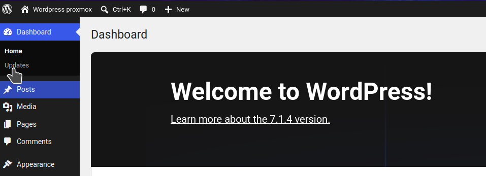
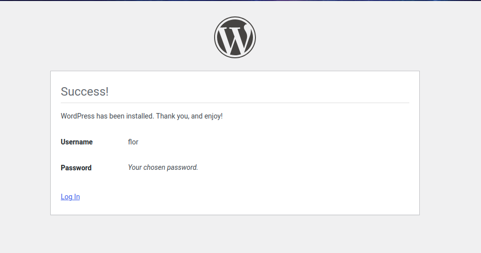
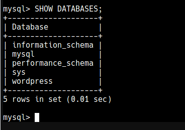
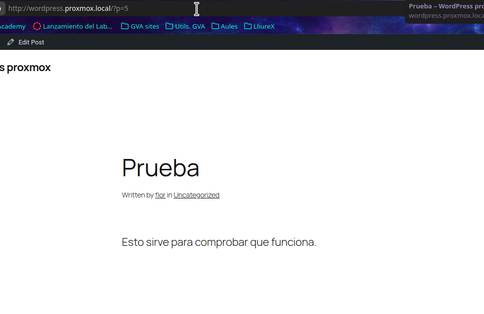

usuario wordpress: flor contraseña: 1122334455667788_






# Práctica 3a - Instalación de WordPress y creación de una plantilla en Proxmox

## 1. Actualización del contenedor

Una vez creado el contenedor LXC 110 (`mi-wordpress`) con Ubuntu 26.04 y comprobada su conexión a Internet, accedemos desde la Shell de Proxmox:

```bash
pct enter 110
```

Actualizamos los repositorios:

```bash
apt update
```

---

## 2. Instalación de Apache, PHP y MySQL

Instalamos los servicios necesarios para ejecutar WordPress:

```bash
apt install -y apache2 mysql-server php libapache2-mod-php php-mysql php-curl php-gd php-mbstring php-xml php-zip php-intl unzip wget
```

Habilitamos e iniciamos los servicios:

```bash
systemctl enable --now apache2 mysql
```

Comprobamos su funcionamiento:

```bash
systemctl status apache2
systemctl status mysql
```

Ambos servicios deben aparecer como `active (running)`.


## 3. Creación de la base de datos

Accedemos a MySQL:

```bash
mysql -u root
```

Creamos la base de datos para WordPress:

```sql
CREATE DATABASE wordpress
CHARACTER SET utf8mb4
COLLATE utf8mb4_unicode_ci;
```

Creamos un usuario específico:

```sql
CREATE USER 'wp_user'@'localhost'
IDENTIFIED BY '1';
```

Asignamos los permisos necesarios:

```sql
GRANT ALL PRIVILEGES ON wordpress.*
TO 'wp_user'@'localhost';
```

Comprobamos la creación de la base de datos:

```sql
SHOW DATABASES;
```
- 
Salimos de MySQL:

```sql
EXIT;
```

Utilizamos `localhost` porque WordPress y MySQL están instalados en el mismo contenedor. No necesitamos permitir conexiones remotas a MySQL.


## 4. Descarga e instalación de WordPress

Descargamos WordPress desde su página oficial:

```bash
cd /tmp
wget https://wordpress.org/latest.tar.gz
```

Descomprimimos el archivo:

```bash
tar -xzf latest.tar.gz
```

Creamos el directorio de la aplicación:

```bash
mkdir -p /var/www/wordpress
```

Copiamos los archivos:

```bash
cp -a /tmp/wordpress/. /var/www/wordpress/
```

### Configuración de permisos

Asignamos los permisos correspondientes:

```bash
chown -R root:www-data /var/www/wordpress

find /var/www/wordpress -type d -exec chmod 755 {} \;

find /var/www/wordpress -type f -exec chmod 644 {} \;
```

Permitimos que Apache pueda modificar los archivos necesarios dentro de `wp-content`:

```bash
chown -R www-data:www-data /var/www/wordpress/wp-content
```

Este directorio contiene los temas, plugins y archivos multimedia de WordPress.


---

## 5. Configuración de WordPress

Accedemos al directorio:

```bash
cd /var/www/wordpress
```

Creamos el archivo de configuración a partir del ejemplo:

```bash
cp wp-config-sample.php wp-config.php
```

Lo editamos:

```bash
nano wp-config.php
```

Modificamos los parámetros de conexión:

```php
define( 'DB_NAME', 'wordpress' );
define( 'DB_USER', 'wp_user' );
define( 'DB_PASSWORD', '1' );
define( 'DB_HOST', 'localhost' );
```

Estos parámetros permiten que WordPress se conecte a la base de datos instalada en el mismo contenedor.

Protegemos el archivo:

```bash
chown root:www-data /var/www/wordpress/wp-config.php
chmod 640 /var/www/wordpress/wp-config.php
```

De esta manera, Apache puede leer la configuración sin conceder permisos innecesarios.

---

## 6. Configuración de Apache

Configuramos un VirtualHost para acceder a WordPress mediante el nombre `wordpress.proxmox.local`.

Creamos el archivo:

```bash
nano /etc/apache2/sites-available/wordpress.conf
```

Añadimos:

```apache
<VirtualHost *:80>
    ServerName wordpress.proxmox.local
    DocumentRoot /var/www/wordpress

    <Directory /var/www/wordpress>
        AllowOverride All
        Require all granted
    </Directory>

    ErrorLog ${APACHE_LOG_DIR}/wordpress-error.log
    CustomLog ${APACHE_LOG_DIR}/wordpress-access.log combined
</VirtualHost>
```

Activamos el módulo Rewrite, necesario para las URL amigables de WordPress:

```bash
a2enmod rewrite
```

Activamos el sitio:

```bash
a2ensite wordpress.conf
```

Desactivamos el sitio predeterminado de Apache:

```bash
a2dissite 000-default.conf
```

Recargamos Apache:

```bash
systemctl reload apache2
```
---

## 7. Configuración del dominio local

Para acceder a WordPress mediante su nombre, modificamos el archivo `/etc/hosts` de nuestro ordenador Linux.

Ejecutamos desde el anfitrión:

```bash
sudo nano /etc/hosts
```

Añadimos la siguiente entrada:

```text
192.168.40.20 wordpress.proxmox.local
```

Comprobamos la resolución:

```bash
getent hosts wordpress.proxmox.local
```

De esta manera, el nombre `wordpress.proxmox.local` se resuelve a la IP del contenedor 110.

---

## 8. Instalación de WordPress desde el navegador

Accedemos a:

**http://wordpress.proxmox.local**

Aparece el asistente de instalación de WordPress.

Configuramos el título del sitio, usuario administrador, contraseña y correo electrónico.

Una vez completada la instalación, WordPress muestra el mensaje de instalación correcta.

Accedemos al panel de administración y comprobamos que funciona.

- 
- 

---

## 9. Creación de una entrada de prueba

Antes de convertir el contenedor en plantilla, creamos una entrada para comprobar posteriormente que los datos se conservan.

Desde WordPress:

**Posts → Add Post**

Creamos la siguiente entrada:

- **Título:** Prueba
- **Contenido:** Esto sirve para comprobar que funciona.

Publicamos la entrada y comprobamos que aparece en la página web.

Esta entrada nos permitirá verificar que el clon conserva los datos de WordPress.

- 

---

## 10. Comprobación de la base de datos

Desde la Shell de Proxmox comprobamos los servicios:

```bash
pct exec 110 -- systemctl is-active apache2
pct exec 110 -- systemctl is-active mysql
```

Ambos servicios estaban activos.

También comprobamos las tablas de WordPress:

```bash
pct exec 110 -- mysql -u root -e "SHOW TABLES FROM wordpress;"
```

Aparecieron las tablas creadas durante la instalación, entre ellas:

- `wp_posts`
- `wp_users`
- `wp_options`
- `wp_comments`
- `wp_postmeta`

Esto confirma que WordPress utiliza correctamente su base de datos MySQL.

---

## 11. Preparación del contenedor para convertirlo en plantilla

Una vez comprobado el funcionamiento de WordPress, preparamos el contenedor 110 para convertirlo en plantilla.

El contenedor utilizaba:

- IP: `192.168.40.20/24`
- Gateway: `192.168.40.1`
- Bridge: `vmbr0`

### Eliminar la configuración IP específica

Desde la interfaz de Proxmox, accedemos a:

**110 → Network → net0 → Edit**

Retiramos la IP estática y el gateway específicos, manteniendo la interfaz `net0` conectada a `vmbr0`.

Esto evita que los futuros clones hereden la misma IP y provoquen conflictos en la red.

También retiramos la configuración DNS específica de la plantilla.

### Limpiar el identificador de máquina

Desde Proxmox ejecutamos:

```bash
pct exec 110 -- truncate -s 0 /etc/machine-id
```

Así preparamos el contenedor para que cada clon tenga un identificador de máquina propio.

Después de realizar este paso, no volvemos a iniciar el contenedor original.

---

## 12. Conversión del contenedor en plantilla

Detenemos el contenedor:

```bash
pct shutdown 110
```

Desde la interfaz de Proxmox seleccionamos:

**110 → More → Convert to template**

Confirmamos la operación.

- 

---

## 13. Creación de un clon completo

Seleccionamos la plantilla 110 y pulsamos **Clone**.


### Configuración de red

Antes de iniciarlo, configuramos la interfaz `net0`:

| Parámetro | Valor |
|---|---|
| Bridge | vmbr0 |
| IPv4 | Static |
| IP | 192.168.40.21/24 |
| Gateway | 192.168.40.1 |
| DNS | 1.1.1.1 |

Utilizamos una dirección diferente de la del contenedor original para evitar conflictos de IP.

---

## 14. Comprobación del clon

Iniciamos el contenedor clonado:

```bash
pct start 111
```

Verificamos la configuración de red:

```bash
pct exec 111 -- ip -br address
pct exec 111 -- ip route
pct exec 111 -- cat /etc/resolv.conf
```

Comprobamos la conexión a Internet:

```bash
pct exec 111 -- ping -c 3 google.com
```

### Comprobación de Apache y MySQL

```bash
pct exec 111 -- systemctl is-active apache2
pct exec 111 -- systemctl is-active mysql
```

Comprobamos las tablas de la base de datos:

```bash
pct exec 111 -- mysql -u root -e "SHOW TABLES FROM wordpress;"
```

Los servicios funcionaban correctamente y las tablas seguían presentes.

---

## 15. Acceso a WordPress desde el clon

Modificamos nuevamente el archivo `/etc/hosts` del ordenador anfitrión:

```bash
sudo nano /etc/hosts
```

Sustituimos la IP del contenedor original por la del clon:

```text
192.168.40.21 wordpress.proxmox.local
```

Comprobamos la resolución:

```bash
getent hosts wordpress.proxmox.local
```

Accedimos desde el navegador:

**http://wordpress.proxmox.local**

La página cargó correctamente y apareció la entrada original:

**Prueba**

Con el contenido:

**Esto sirve para comprobar que funciona.**

Esto demuestra que la plantilla conservó el contenido de WordPress y que los datos se copiaron correctamente al clon.

**Captura 12:** WordPress funcionando desde el clon y mostrando la entrada original.

---

## 16. Comprobación de la independencia del clon

Para demostrar que el clon puede almacenar sus propios datos, creamos una nueva entrada desde WordPress:

**Posts → Add Post**


Publicamos la entrada y verificamos que aparece en WordPress.

Después comprobamos los registros de MySQL:

```bash
pct exec 111 -- mysql -u root -e "SELECT ID, post_title, post_status FROM wordpress.wp_posts WHERE post_type='post';"
```

La consulta permitió verificar que el clon conservaba la entrada original y almacenaba también la nueva.

Al tratarse de un Full Clone, el contenedor dispone de una copia independiente de la base de datos.

**Captura 13:** Entradas almacenadas en MySQL desde el clon.

---


## 20. Conclusión

En esta práctica hemos instalado WordPress y su base de datos MySQL en un contenedor LXC de Proxmox.

Configuramos Apache, PHP y MySQL, y comprobamos el funcionamiento de WordPress mediante la creación de una entrada de prueba.

Posteriormente preparamos el contenedor para convertirlo en plantilla, eliminando la configuración de red específica y limpiando el identificador de máquina.

Una vez convertida la plantilla, creamos un clon completo con una dirección IP diferente.

Comprobamos que el clon conservaba WordPress, sus tablas MySQL y la entrada que habíamos publicado antes de la conversión.

Finalmente, creamos una nueva entrada desde el clon para demostrar que podía guardar sus propios datos.

Esta práctica nos ha permitido comprender cómo funcionan las plantillas y los clones en Proxmox, y cómo podemos utilizarlos para desplegar nuevas instancias de una aplicación sin tener que repetir toda su instalación.


# Práctica 3b. Creación de Compra Paiporta con WordPress

## 1. Objetivo

El objetivo de esta práctica es crear una página web utilizando WordPress en Proxmox.

La web se llama **Compra Paiporta** y está orientada a promocionar los comercios locales, sus ofertas y los eventos del municipio.

## 2. Preparación de WordPress

Para esta práctica reutilizamos el contenedor LXC que habíamos clonado en la práctica anterior.

Datos del contenedor:

- **ID:** 111
- **Nombre:** wordpress-clon
- **IP:** 192.168.40.21
- **Dominio:** comercio.paiporta.local

Configuramos Apache y WordPress para acceder a la web mediante el nuevo dominio.

También modificamos las direcciones `siteurl` y `home` de la base de datos, ya que WordPress seguía redirigiendo al dominio anterior.

Finalmente, comprobamos que podíamos acceder al panel de administración:

http://comercio.paiporta.local/wp-admin/


## 3. Configuración del sitio

Desde el panel de administración configuramos la información principal de la web:

- **Nombre:** Compra Paiporta
- **Descripción:** Plataforma dedicada al comercio local.
- **Zona horaria:** Madrid.
- **Enlaces permanentes:** Nombre de la entrada.

También configuramos la página Inicio como portada estática.

## 4. Creación de páginas

Creamos las siguientes páginas:

- Inicio
- Comercio
- Cupones
- Eventos
- Ayuda
- Contacto
- Mi perfil

Cada página contiene información relacionada con su sección.


## 5. Creación de noticias y comercios

Creamos una entrada de noticias titulada **Novedades del sitio**.

También añadimos dos comercios ficticios:

- Panadería El Forn de Paiporta.
- Floristería La Plaça.

Incluimos información de los establecimientos y utilizamos imágenes para acompañar el contenido.

Además, organizamos las entradas mediante categorías.


## 6. Cupones y eventos

En la página Cupones añadimos ofertas de ejemplo relacionadas con los comercios.

También completamos la página Eventos con actividades ficticias de Paiporta.

El objetivo es mostrar cómo se podría utilizar la web para promocionar ofertas y actividades locales.

## 7. Menú de navegación y portada

Configuramos el menú principal para navegar entre las distintas páginas.

Después editamos la página Inicio y añadimos:

- Título y presentación de Compra Paiporta.
- Tres columnas principales: Comercio, Cupones y Eventos.
- Enlaces a Ayuda y Mi perfil.
- Un enlace a Contacto para los comercios interesados.

De esta forma, los visitantes pueden acceder fácilmente a las distintas secciones.


## 8. Copia de seguridad de la base de datos

Realizamos una copia de seguridad de la base de datos de WordPress mediante `mysqldump`.

Comando utilizado:

    mysqldump -u root --single-transaction wordpress > /root/backups/wordpress.sql

Comprobamos que el archivo se había generado correctamente.

Esta copia permite conservar la información almacenada en la base de datos.


## 9. Exportación del contenido

Para poder reutilizar la web en AWS, exportamos su contenido desde WordPress.

Accedimos a:

**Tools → Export → All content → Download Export File**

Descargamos un archivo XML que contiene las páginas, entradas y otros contenidos de WordPress.

Este archivo se utilizará posteriormente para importar el contenido a WordPress en AWS.


## 10. Comprobaciones finales

Accedimos a la web desde el navegador y comprobamos su funcionamiento.

También revisamos:

- El acceso a las páginas.
- Los enlaces del menú.
- La presentación de la portada.
- La visualización desde un dispositivo móvil.

La web funciona correctamente desde la dirección:

http://comercio.paiporta.local


## 11. Conclusión

En esta práctica hemos creado una web de comercio local utilizando WordPress sobre un contenedor LXC de Proxmox.

Hemos aprendido a configurar WordPress, crear páginas y entradas, organizar el contenido, diseñar la portada y configurar la navegación.

Además, hemos realizado una copia de seguridad de la base de datos y exportado el contenido para poder trasladarlo posteriormente a AWS.
