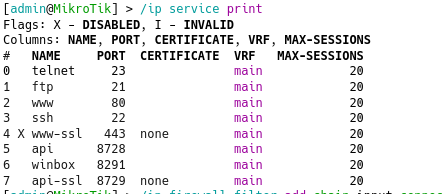
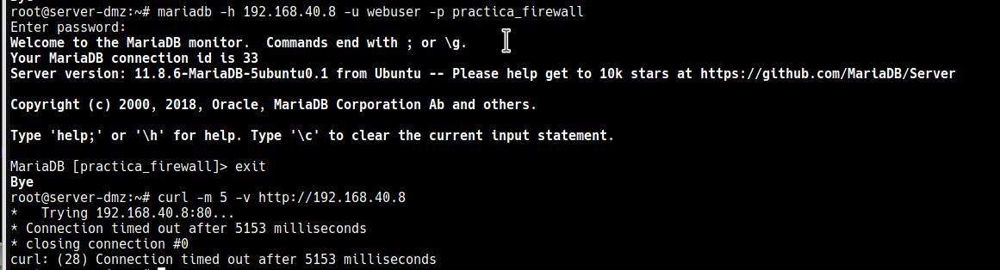
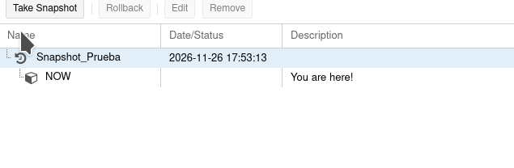

# Tarea 5 - Configuración de firewall en MikroTik

## 1. Configuración de LAN y DMZ

Para esta práctica aprovechamos dos redes que ya teníamos configuradas en Proxmox y MikroTik.

| Red | Dirección | Bridge | Contenedor |
|---|---|---|---|
| LAN | 192.168.40.0/24 | vmbr0 | bd-lan |
| DMZ | 192.168.30.0/24 | vmbr1 | server-dmz |

Creamos dos contenedores LXC con Ubuntu y configuramos sus direcciones IP:

| Contenedor | IP | Gateway |
|---|---|---|
| bd-lan | 192.168.40.8 | 192.168.40.1 |
| server-dmz | 192.168.30.8 | 192.168.30.1 |

El servidor de base de datos está en la LAN y el servidor web en la DMZ, para poder controlar las conexiones entre ambos.


## 2. Comprobación de MikroTik

Antes de empezar comprobamos las interfaces, las direcciones IP y las rutas configuradas.

```routeros
/ip address print
/interface print
/ip route print
```

Después revisamos las reglas NAT y FILTER existentes:

```routeros
/ip firewall nat print detail
/ip firewall filter print detail
```

Comprobamos que ya existía una regla `masquerade` por `wlan1`, por lo que no fue necesario crearla de nuevo.
- 

## 3. Configuración NAT

Creamos una regla de port forwarding para permitir que las conexiones HTTP que llegan a MikroTik por `wlan1` se redirijan al servidor Apache de la DMZ.

```routeros
/ip firewall nat add chain=dstnat in-interface=wlan1 protocol=tcp dst-port=80 action=dst-nat to-addresses=192.168.30.8 to-ports=80 comment="HTTP hacia servidor DMZ"
```

Comprobamos las reglas:

```routeros
/ip firewall nat print
```

Así conseguimos que el servidor web sea accesible desde la red exterior mediante la dirección `http://10.250.187.132`.


## 4. Configuración de FILTER

### Permitir conexiones establecidas

Creamos una regla para permitir las conexiones que ya estaban establecidas hacia MikroTik.

```routeros
/ip firewall filter add chain=input connection-state=established,related,untracked action=accept comment="Permitir conexiones establecidas"
```

También permitimos las respuestas de conexiones ya establecidas entre redes.

```routeros
/ip firewall filter add chain=forward connection-state=established,related,untracked action=accept comment="Permitir conexiones existentes entre redes"
```

### Proteger la administración de MikroTik

Primero comprobamos los servicios de administración disponibles:

```routeros
/ip service print
```

- 

Después bloqueamos el acceso a WebFig desde Internet:

```routeros
/ip firewall filter add chain=input in-interface=wlan1 protocol=tcp dst-port=80 action=drop comment="Bloquear WebFig desde Internet"
```

También añadimos una regla para bloquear las conexiones nuevas hacia el propio MikroTik desde `wlan1`.

```routeros
/ip firewall filter add chain=input in-interface=wlan1 connection-state=new action=drop comment="Bloquear acceso externo a MikroTik"
```

Con esto restringimos los accesos externos a los servicios del router.

### Bloquear DMZ hacia LAN

Creamos una regla para evitar que los equipos de la DMZ accedan libremente a la LAN.

```routeros
/ip firewall filter add chain=forward src-address=192.168.30.0/24 dst-address=192.168.40.0/24 action=drop comment="Bloquear DMZ hacia LAN"
```

### Permitir la conexión a MariaDB

Como el servidor web necesita acceder a la base de datos, creamos una excepción para el puerto TCP 3306.

```routeros
/ip firewall filter add chain=forward src-address=192.168.30.8 dst-address=192.168.40.8 protocol=tcp dst-port=3306 connection-state=new action=accept comment="Permitir Web a MariaDB"
```

Colocamos esta regla antes del bloqueo general para que tenga prioridad.

```routeros
/ip firewall filter move [find comment="Permitir Web a MariaDB"] [find comment="Bloquear DMZ hacia LAN"]
```

### Permitir HTTP desde el exterior

Añadimos una regla para permitir las conexiones HTTP redirigidas mediante NAT al servidor web.

```routeros
/ip firewall filter add chain=forward in-interface=wlan1 connection-nat-state=dstnat protocol=tcp dst-address=192.168.30.8 dst-port=80 action=accept comment="Permitir HTTP exterior a DMZ"
```

Finalmente, comprobamos todas las reglas:

```routeros
/ip firewall filter print
```


## 5. Instalación y configuración de los servicios

En `server-dmz` instalamos Apache:

```bash
apt update
apt install apache2 -y
```

Comprobamos su funcionamiento:

```bash
curl http://localhost
```

En `bd-lan` instalamos MariaDB:

```bash
apt update
apt install mariadb-server -y
```

Modificamos el archivo `/etc/mysql/mariadb.conf.d/50-server.cnf` para que escuchara en `192.168.40.8`.

Después reiniciamos el servicio:

```bash
systemctl restart mariadb
```

Creamos la base de datos `practica_firewall` y el usuario `webuser`, autorizado desde `192.168.30.8`.

En `server-dmz` instalamos el cliente:

```bash
apt install mariadb-client -y
```

Y comprobamos la conexión:

```bash
mariadb -h 192.168.40.8 -u webuser -p practica_firewall
```

Conseguimos acceder correctamente a la base de datos desde la DMZ.




## Conclusión

En esta práctica hemos configurado las reglas NAT y FILTER de MikroTik para separar la LAN y la DMZ.

Hemos permitido el acceso exterior al servidor web, bloqueado las conexiones generales desde la DMZ hacia la LAN y creado una excepción para que Apache pueda comunicarse con MariaDB.

Finalmente, hemos comprobado que las conexiones permitidas funcionan y que los accesos restringidos no se establecen.


# Práctica 5d. Snapshot, Backup y Restauración en Proxmox VE

## 1. Objetivo

El objetivo de esta práctica es aprender a crear snapshots, realizar copias de seguridad y restaurar contenedores LXC en Proxmox.

Para ello utilizamos nuestro contenedor de WordPress, donde tenemos alojada la página web **Compra Paiporta**.


## 3. Comprobación inicial


Comprobamos los almacenamientos disponibles:

    pvesm status

También revisamos los snapshots existentes:

    pct listsnapshot 111

El contenedor 111 estaba almacenado en `zfs-lab`, compatible con snapshots.


## 4. Creación del snapshot

Primero apagamos el contenedor WordPress:

    pct shutdown 111

Comprobamos que estaba apagado:

    pct status 111

Después creamos un snapshot llamado `snap-wordpress`:

    pct snapshot 111 snap-wordpress --description "Snapshot de prueba WordPress"

Comprobamos que se había creado:

    pct listsnapshot 111

El snapshot permite guardar el estado del contenedor en un momento determinado.
- 

## 5. Comprobación del snapshot y rollback

Iniciamos el contenedor:

    pct start 111

Creamos un archivo de prueba después de realizar el snapshot:

    pct exec 111 -- sh -c 'echo "creado despues del snapshot" > /root/test.txt'

Comprobamos su contenido:

    pct exec 111 -- cat /root/test.txt

Apareció el texto:

    creado despues del snapshot

Después apagamos el contenedor:

    pct shutdown 111

Realizamos el rollback:

    pct rollback 111 snap-wordpress

Volvimos a iniciar el contenedor:

    pct start 111

Finalmente, comprobamos que el archivo había desaparecido:

    pct exec 111 -- test ! -e /root/test.txt && echo "Rollback correcto"

El resultado fue:

    Rollback correcto

Esto demuestra que el contenedor volvió al estado que tenía cuando se creó el snapshot.


## 6. Creación del backup con VZDUMP

Después realizamos una copia de seguridad completa del contenedor WordPress.


Ejecutamos el backup:

    vzdump 111 --storage local --mode snapshot --compress zstd

Este comando:

- Realiza una copia del contenedor 111.
- Guarda el backup en `local`.
- Utiliza el modo snapshot.
- Comprime el archivo con Zstandard.

La operación terminó correctamente y apareció el mensaje:

    Backup job finished successfully

Comprobamos el archivo generado:

    pvesm list local --content backup


## 7. Restauración del backup

Para comprobar que el backup funcionaba, decidimos restaurarlo como un nuevo contenedor.

Elegimos el ID **114**, para no modificar nuestro WordPress original.

Después ejecutamos:

    pct create 114 \
      local:backup/vzdump-lxc-111-2026_11_26-18_05_23.tar.zst \
      --restore 1 \
      --storage zfs-lab \
      --unique 1

Este comando restauró el backup y creó un nuevo contenedor LXC.

Comprobamos su estado y configuración:

    pct status 114
    pct config 114

El nuevo contenedor tenía:

- 1 núcleo de CPU.
- 1024 MiB de RAM.
- Disco de 12 GB.
- Sistema operativo Ubuntu.
- Archivos y servicios de WordPress.


## 8. Configuración de red del contenedor restaurado

El contenedor restaurado conservaba la IP del original:

    192.168.40.25

Para evitar conflictos, modificamos la interfaz de red del contenedor 114:

    pct set 114 --net0 "name=eth0,bridge=vmbr1,ip=manual,firewall=1"

Comprobamos la configuración:

    pct config 114 | grep '^net'

También revisamos las interfaces del servidor Proxmox:

    cat /etc/network/interfaces

Comprobamos que `vmbr1` estaba conectado a la red `192.168.30.0/24`.

Mantuvimos la interfaz `net0` del contenedor 114, pero sin asignarle una dirección IP.

De esta forma evitamos que utilizara la IP del WordPress original.


## 9. Comprobación de los servicios restaurados

Iniciamos el contenedor 114:

    pct start 114

Comprobamos su estado:

    pct status 114

Después verificamos que Apache funcionaba:

    pct exec 114 -- systemctl is-active apache2

También comprobamos MySQL:

    pct exec 114 -- systemctl is-active mysql

Los dos servicios devolvieron:

    active

Comprobamos los archivos de WordPress:

    pct exec 114 -- ls -lah /var/www/wordpress/

Aparecieron los archivos y carpetas originales, como:

- wp-admin
- wp-content
- wp-includes
- index.php
- wp-login.php

Esto confirmó que habíamos recuperado los archivos y servicios de WordPress.


## 10. Comprobación de la base de datos

Comprobamos que la base de datos WordPress también se había restaurado:

    pct exec 114 -- mysql -u root -e "SHOW DATABASES;"

Apareció la base:

    wordpress

Después consultamos las publicaciones:

    pct exec 114 -- mysql -u root wordpress -e "SELECT post_title FROM wp_posts WHERE post_status='publish' AND post_type IN ('page','post');"

El resultado mostró las páginas y entradas de Compra Paiporta:

- INICIO
- Comercio
- Cupones
- Eventos
- Ayuda
- Contacto
- Mi perfil
- Novedades del sitio
- Panadería El Forn de Paiporta
- Floristería La Plaça

Por tanto, comprobamos que el backup también había recuperado los datos de MySQL.


## 11. Finalización de la práctica

Una vez realizadas las comprobaciones, apagamos el contenedor 114:

    pct shutdown 114

Comprobamos su estado:

    pct status 114

El contenedor quedó apagado.

Decidimos conservar:

- El contenedor original 111.
- El contenedor restaurado 114.
- El snapshot `snap-wordpress`.
- El backup generado con VZDUMP.

No eliminamos ninguno de estos elementos.

## 12. Diferencia entre snapshot y backup

| Snapshot | Backup |
|---|---|
| Guarda el estado del contenedor | Genera una copia de seguridad |
| Permite realizar un rollback | Permite restaurar otro contenedor |
| Normalmente depende del almacenamiento original | Puede guardarse en otro almacenamiento |
| Es útil para deshacer cambios | Es útil para recuperar el sistema |

Los comandos más importantes son:

### Crear un snapshot

    pct snapshot 111 snap-wordpress

### Restaurar un snapshot

    pct rollback 111 snap-wordpress

### Crear un backup

    vzdump 111 --storage local --mode snapshot --compress zstd

### Consultar los backups

    pvesm list local --content backup

### Restaurar un contenedor

    pct create 114 ARCHIVO_BACKUP --restore 1 --storage zfs-lab --unique 1

## 13. Observaciones

La restauración se realizó correctamente y comprobamos que Apache, MySQL y los contenidos de WordPress estaban disponibles en el contenedor 114.

Sin embargo, no comprobamos el funcionamiento de la página web desde un navegador, ya que el contenedor restaurado se mantuvo sin dirección IP para evitar conflictos con el original.

Por tanto, verificamos la recuperación del contenedor y sus datos, pero quedó pendiente la prueba de acceso web.

Además, conservamos el snapshot y el backup para poder utilizarlos posteriormente si fuera necesario.

## 14. Conclusión

En esta práctica hemos aprendido a utilizar las herramientas de Proxmox para proteger y recuperar contenedores LXC.

Primero creamos un snapshot de WordPress y comprobamos su funcionamiento mediante un rollback.

Después realizamos un backup completo con VZDUMP y lo restauramos como un nuevo contenedor con ID 114.

Finalmente, comprobamos que Apache, MySQL, los archivos y las publicaciones de WordPress se habían recuperado correctamente.

Con esta práctica hemos entendido la diferencia entre un snapshot, un backup y una restauración.
