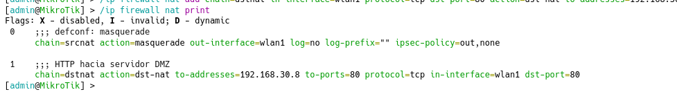
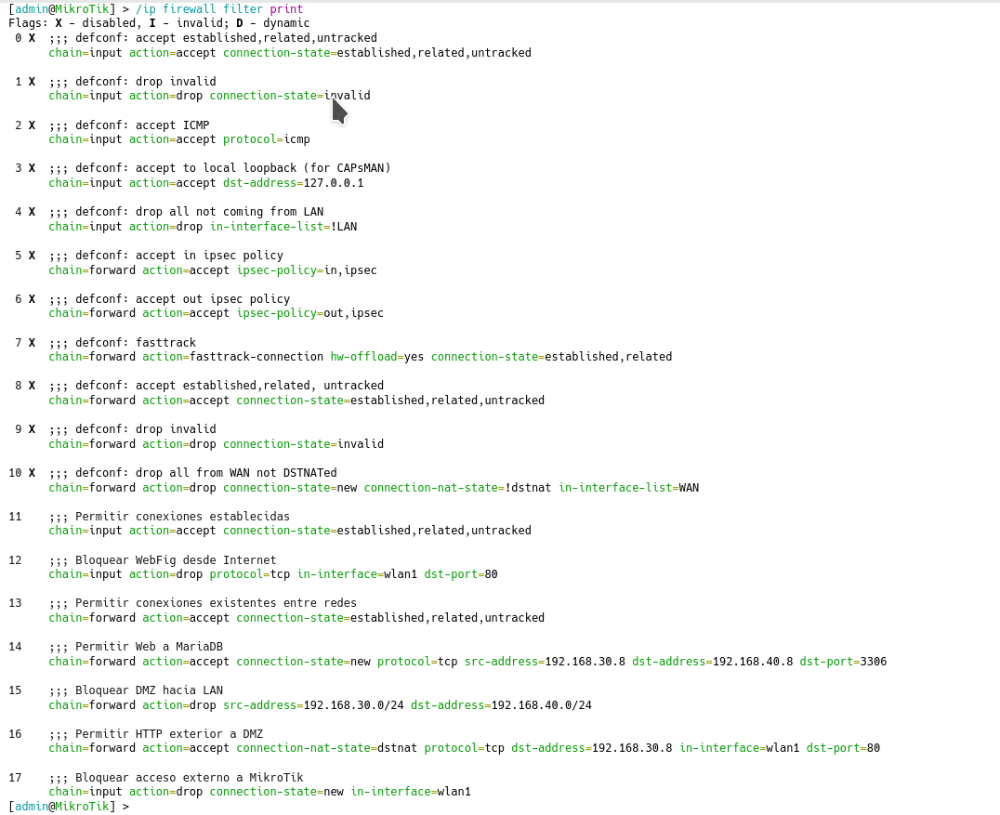

# Tarea 5 - Configuración de firewall en MikroTik

## 1. Configuración de LAN y DMZ

Para esta práctica aprovechamos dos redes que ya teníamos configuradas en Proxmox y MikroTik.

| Red | Dirección | Bridge | Contenedor |
|---|---|---|---|
| LAN | 192.168.40.0/24 | vmbr0 | bd-lan |
| DMZ | 192.168.30.0/24 | vmbr1 | server-dmz |

Creamos dos contenedores LXC con Ubuntu y configuramos sus direcciones IP:

| Contenedor | IP | Gateway |
|---|---|---|
| bd-lan | 192.168.40.8 | 192.168.40.1 |
| server-dmz | 192.168.30.8 | 192.168.30.1 |

El servidor de base de datos está en la LAN y el servidor web en la DMZ, para poder controlar las conexiones entre ambos.


## 2. Comprobación de MikroTik

Antes de empezar comprobamos las interfaces, las direcciones IP y las rutas configuradas.

```routeros
/ip address print
/interface print
/ip route print
```

Después revisamos las reglas NAT y FILTER existentes:

```routeros
/ip firewall nat print detail
/ip firewall filter print detail
```

Comprobamos que ya existía una regla `masquerade` por `wlan1`, por lo que no fue necesario crearla de nuevo.
- 

## 3. Configuración NAT

Creamos una regla de port forwarding para permitir que las conexiones HTTP que llegan a MikroTik por `wlan1` se redirijan al servidor Apache de la DMZ.

```routeros
/ip firewall nat add chain=dstnat in-interface=wlan1 protocol=tcp dst-port=80 action=dst-nat to-addresses=192.168.30.8 to-ports=80 comment="HTTP hacia servidor DMZ"
```

Comprobamos las reglas:

```routeros
/ip firewall nat print
```

Así conseguimos que el servidor web sea accesible desde la red exterior mediante la dirección `http://10.250.187.132`.


## 4. Configuración de FILTER

### Permitir conexiones establecidas

Creamos una regla para permitir las conexiones que ya estaban establecidas hacia MikroTik.

```routeros
/ip firewall filter add chain=input connection-state=established,related,untracked action=accept comment="Permitir conexiones establecidas"
```

También permitimos las respuestas de conexiones ya establecidas entre redes.

```routeros
/ip firewall filter add chain=forward connection-state=established,related,untracked action=accept comment="Permitir conexiones existentes entre redes"
```

### Proteger la administración de MikroTik

Primero comprobamos los servicios de administración disponibles:

```routeros
/ip service print
```

- 

Después bloqueamos el acceso a WebFig desde Internet:

```routeros
/ip firewall filter add chain=input in-interface=wlan1 protocol=tcp dst-port=80 action=drop comment="Bloquear WebFig desde Internet"
```

También añadimos una regla para bloquear las conexiones nuevas hacia el propio MikroTik desde `wlan1`.

```routeros
/ip firewall filter add chain=input in-interface=wlan1 connection-state=new action=drop comment="Bloquear acceso externo a MikroTik"
```

Con esto restringimos los accesos externos a los servicios del router.

### Bloquear DMZ hacia LAN

Creamos una regla para evitar que los equipos de la DMZ accedan libremente a la LAN.

```routeros
/ip firewall filter add chain=forward src-address=192.168.30.0/24 dst-address=192.168.40.0/24 action=drop comment="Bloquear DMZ hacia LAN"
```

### Permitir la conexión a MariaDB

Como el servidor web necesita acceder a la base de datos, creamos una excepción para el puerto TCP 3306.

```routeros
/ip firewall filter add chain=forward src-address=192.168.30.8 dst-address=192.168.40.8 protocol=tcp dst-port=3306 connection-state=new action=accept comment="Permitir Web a MariaDB"
```

Colocamos esta regla antes del bloqueo general para que tenga prioridad.

```routeros
/ip firewall filter move [find comment="Permitir Web a MariaDB"] [find comment="Bloquear DMZ hacia LAN"]
```

### Permitir HTTP desde el exterior

Añadimos una regla para permitir las conexiones HTTP redirigidas mediante NAT al servidor web.

```routeros
/ip firewall filter add chain=forward in-interface=wlan1 connection-nat-state=dstnat protocol=tcp dst-address=192.168.30.8 dst-port=80 action=accept comment="Permitir HTTP exterior a DMZ"
```

Finalmente, comprobamos todas las reglas:

```routeros
/ip firewall filter print
```



## 5. Instalación y configuración de los servicios

En `server-dmz` instalamos Apache:

```bash
apt update
apt install apache2 -y
```

Comprobamos su funcionamiento:

```bash
curl http://localhost
```

En `bd-lan` instalamos MariaDB:

```bash
apt update
apt install mariadb-server -y
```

Modificamos el archivo `/etc/mysql/mariadb.conf.d/50-server.cnf` para que escuchara en `192.168.40.8`.

Después reiniciamos el servicio:

```bash
systemctl restart mariadb
```

Creamos la base de datos `practica_firewall` y el usuario `webuser`, autorizado desde `192.168.30.8`.

En `server-dmz` instalamos el cliente:

```bash
apt install mariadb-client -y
```

Y comprobamos la conexión:

```bash
mariadb -h 192.168.40.8 -u webuser -p practica_firewall
```

Conseguimos acceder correctamente a la base de datos desde la DMZ.


## Conclusión

En esta práctica hemos configurado las reglas NAT y FILTER de MikroTik para separar la LAN y la DMZ.

Hemos permitido el acceso exterior al servidor web, bloqueado las conexiones generales desde la DMZ hacia la LAN y creado una excepción para que Apache pueda comunicarse con MariaDB.

Finalmente, hemos comprobado que las conexiones permitidas funcionan y que los accesos restringidos no se establecen.