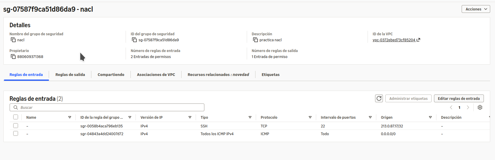
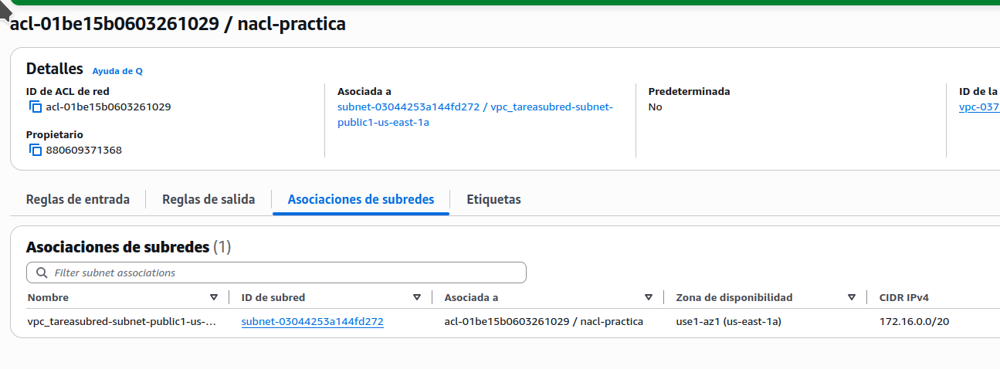
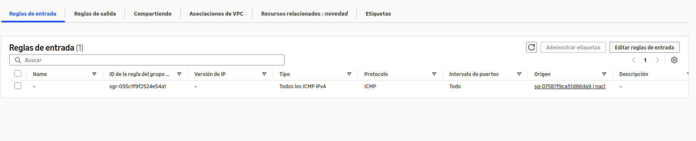
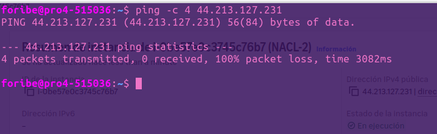
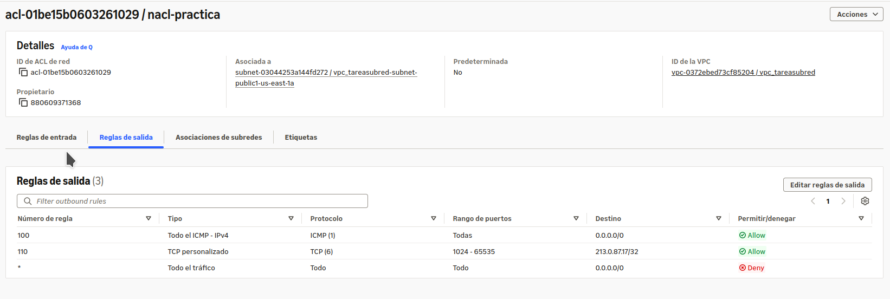
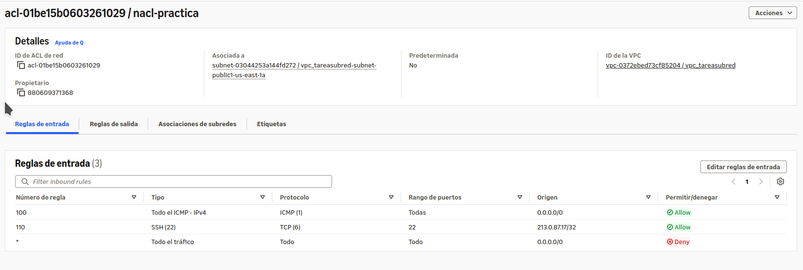
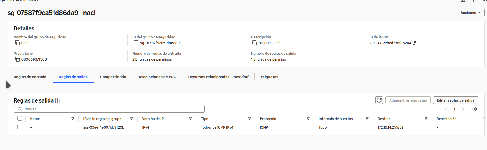
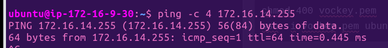

# UP01 - Despliegue de Infraestructura de Red en la Nube

# Práctica: NACLs en AWS

## 1. Creación de la infraestructura

Para esta práctica reutilizamos la VPC `vpc_tareasubred` de la actividad anterior, junto con su subred pública, Internet Gateway y tabla de enrutamiento.

Creamos una instancia Ubuntu llamada `nacl` dentro de la subred pública, habilitando la asignación de IP pública y utilizando la clave `vockey`.

También creamos un grupo de seguridad para permitir el acceso SSH.


## 2. Comprobación del grupo de seguridad

Primero nos conectamos a la instancia mediante SSH:

```bash
chmod 400 vockey.pem
ssh -i vockey.pem ubuntu@3.235.133.101
```

Después, desde nuestro ordenador, realizamos un ping a la IP pública de la instancia:

```bash
ping -c 4 3.235.133.101
```

Inicialmente, el ping no funcionaba porque el grupo de seguridad únicamente permitía SSH.

Añadimos una regla de entrada para permitir **Todo el ICMP IPv4** desde `0.0.0.0/0` y comprobamos que el ping ya respondía.

Después eliminamos todas las reglas de salida del grupo de seguridad y repetimos el ping.

El ping seguía funcionando, demostrando que los grupos de seguridad son **stateful**, ya que permiten automáticamente las respuestas a conexiones autorizadas.


- 


## 3. Creación de la NACL

Desde **VPC → ACL de red**, creamos una nueva NACL llamada `nacl-practica` y la asociamos a nuestra subred pública.

Al crearla comprobamos que, por defecto, todas las conexiones de entrada y salida estaban denegadas.

Esto ocurre porque las NACL personalizadas bloquean todo el tráfico si no añadimos reglas que lo permitan.

- 

## 4. Configuración de ICMP en la NACL

Primero añadimos una regla de entrada:

| Nº | Tipo | Origen | Acción |
|---|---|---|---|
| 100 | Todo ICMP IPv4 | 0.0.0.0/0 | Permitir |

Probamos el ping desde nuestro ordenador, pero seguía sin funcionar.

Esto se debía a que la NACL permitía la entrada ICMP, pero no su salida.

Después añadimos una regla de salida:

| Nº | Tipo | Destino | Acción |
|---|---|---|---|
| 100 | Todo ICMP IPv4 | 0.0.0.0/0 | Permitir |

Volvimos a realizar el ping y esta vez funcionó correctamente.

Con esto comprobamos que las NACL son **stateless**, por lo que necesitan reglas independientes para permitir el tráfico de entrada y salida.


## 5. Creación del grupo de seguridad encadenado

Creamos un segundo grupo de seguridad llamado `gs-encadenado`, dentro de la misma VPC.

Configuramos una regla de entrada ICMP cuyo origen era el grupo de seguridad de nuestra primera instancia:


`sg-07587f9ca51d86da9`

De esta manera, únicamente las instancias que utilizan ese grupo de seguridad pueden enviar ping a los recursos protegidos por `gs-encadenado`.

En las reglas de salida dejamos permitido todo el tráfico.

- 

## 6. Creación de la segunda EC2

Creamos una segunda instancia Ubuntu llamada `ec2-nacl-02`, dentro de la misma subred pública.

Le asignamos el grupo de seguridad `gs-encadenado`.

Desde nuestro ordenador intentamos hacer ping a su IP pública:

```bash
ping -c 4 44.213.127.231
```

El ping no funcionó, ya que este grupo de seguridad no permite conexiones ICMP desde cualquier origen.


## 7. Configuración de SSH en la NACL

Para poder volver a conectarnos por SSH a la primera instancia, añadimos nuevas reglas en la NACL. La IP del ssh es la publica local.

**Reglas de entrada:**

| Nº | Tipo | Origen | Acción |
|---|---|---|---|
| 100 | Todo ICMP IPv4 | 0.0.0.0/0 | Permitir |
| 110 | SSH (22) | 213.0.87.17/32 | Permitir |

**Reglas de salida:**

| Nº | Tipo | Destino | Acción |
|---|---|---|---|
| 100 | Todo ICMP IPv4 | 0.0.0.0/0 | Permitir |
| 110 | TCP 1024-65535 | 213.0.87.17/32 | Permitir |

También actualizamos la IP de origen de la regla SSH del grupo de seguridad, porque nuestra IP pública había cambiado.

Después conseguimos conectarnos:

```bash
ssh -i vockey.pem ubuntu@3.235.133.101
```

- 
- 

## 8. Comprobación entre las dos instancias

Una vez conectados por SSH a la primera instancia, intentamos hacer ping a la IP privada de la segunda EC2:

```bash
ping -c 4 172.16.14.255
```

Inicialmente no funcionaba porque habíamos eliminado las reglas de salida del grupo de seguridad de la primera instancia.

Añadimos una regla de salida ICMP con destino a la IP privada de la segunda EC2.

Volvimos a realizar el ping y esta vez funcionó correctamente.

Esto demuestra que podemos utilizar grupos de seguridad encadenados para permitir la comunicación entre instancias sin abrir el acceso a cualquier dirección IP.

Como ambas instancias están en la misma subred, se comunican directamente mediante sus IP privadas.


- 
- 

## Conclusión

En esta práctica hemos aprendido a configurar grupos de seguridad y NACLs en AWS para controlar el tráfico de red.

Hemos comprobado que los grupos de seguridad son **stateful**, mientras que las NACL son **stateless** y necesitan reglas independientes de entrada y salida.

También hemos utilizado grupos de seguridad encadenados para permitir la comunicación entre dos instancias EC2 de forma más controlada.