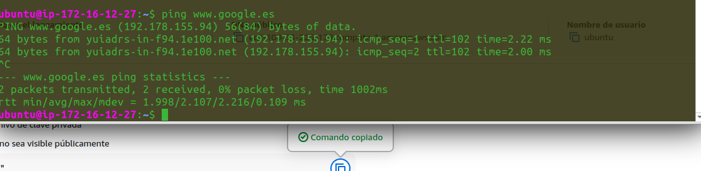
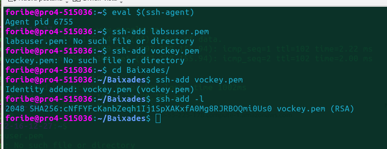
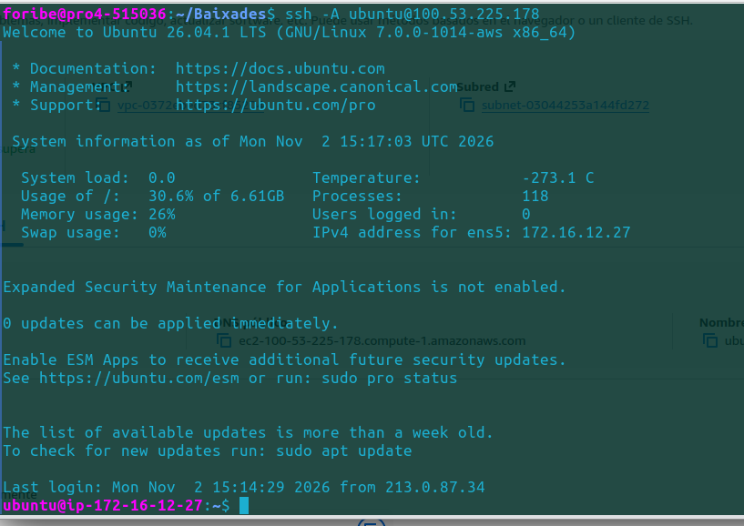
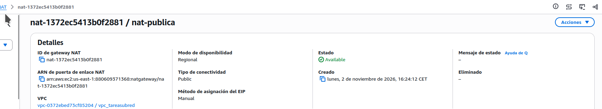
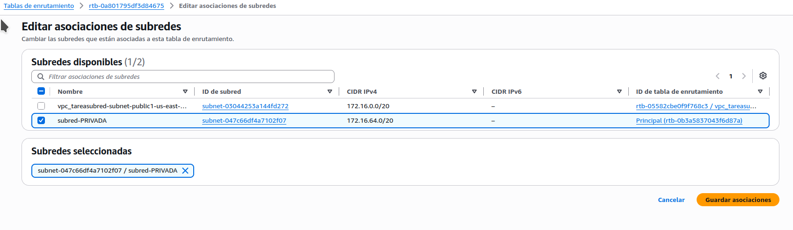
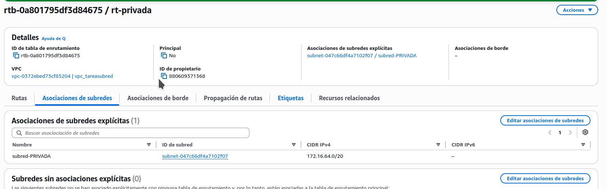
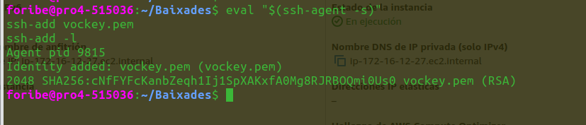
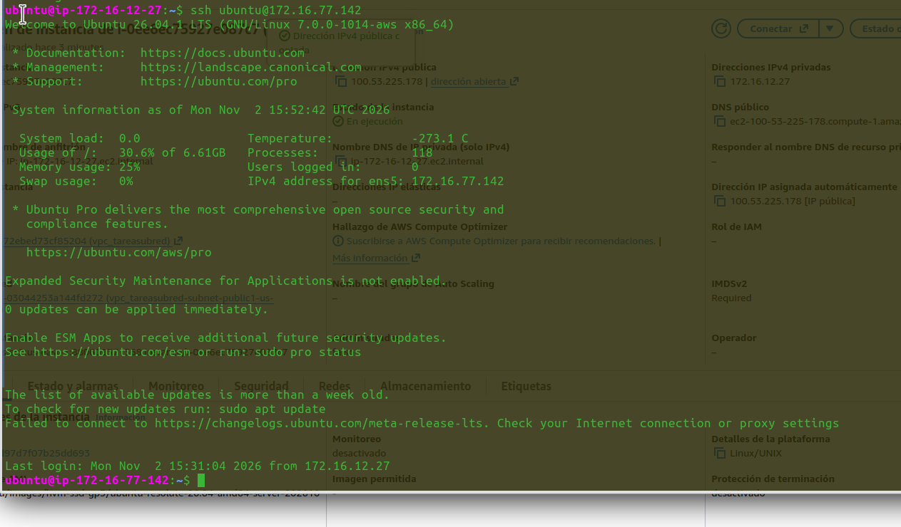

# UP01 ‑ Despliegue de Infraestructura de Red en la Nube

- 












# Práctica: Subredes privadas en AWS

## 1. Creación de la VPC y subredes

Primero creamos una VPC con el rango `172.16.0.0/16` y configuramos dos subredes:

- **Pública:** `172.16.0.0/20`
- **Privada:** `172.16.64.0/20`

También creamos el Internet Gateway para dar salida a Internet a la subred pública.


## 2. Creación de las instancias EC2

Creamos dos instancias Ubuntu, una en cada subred.

## 3. Conexión SSH a las instancias

Primero configuramos los permisos de la clave e iniciamos el agente SSH:

```bash
chmod 400 vockey.pem
eval "$(ssh-agent -s)"
ssh-add vockey.pem
ssh-add -l
```


Nos conectamos a la instancia pública:

```bash
ssh -A ubuntu@100.53.225.178
```

Desde ella accedemos a la privada mediante su IP privada:

```bash
ssh ubuntu@172.16.77.142
```

Comprobamos que la instancia privada todavía no tiene acceso a Internet:

```bash
ping -c 4 www.google.es
```



## 4. Creación del NAT Gateway

Desde **VPC → Gateways NAT**, creamos un NAT Gateway con conectividad pública y le asignamos una IP elástica.

Comprobamos que su estado sea `Available`.

📸 **Captura:** NAT Gateway creado y en estado Available.

## 5. Configuración de la tabla de rutas

Creamos una tabla de enrutamiento llamada `rt-privada` y la asociamos a la subred privada.

Después añadimos la ruta hacia el NAT Gateway:

| Destino | Objetivo |
|---|---|
| 172.16.0.0/16 | local |
| 0.0.0.0/0 | NAT Gateway |

📸 **Capturas:** Rutas configuradas y asociación con la subred privada.

## 6. Comprobación final

Volvemos a la instancia privada y comprobamos la conexión:

```bash
ping -c 4 8.8.8.8
ping -c 4 www.google.es
```

Esta vez el ping funciona correctamente, por lo que la instancia privada ya tiene salida a Internet a través del NAT Gateway.

📸 **Captura:** Ping funcionando desde la instancia privada.

## Conclusión

Hemos creado una red con una subred pública y otra privada, configurando el acceso SSH entre ambas y utilizando un NAT Gateway para que la instancia privada pueda conectarse a Internet sin permitir el acceso directo desde el exterior.