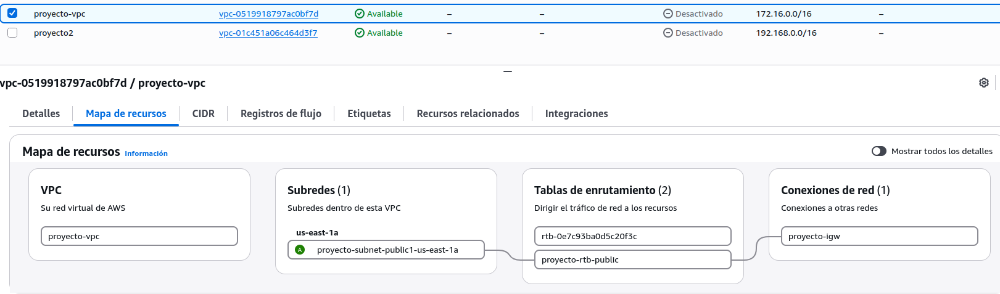
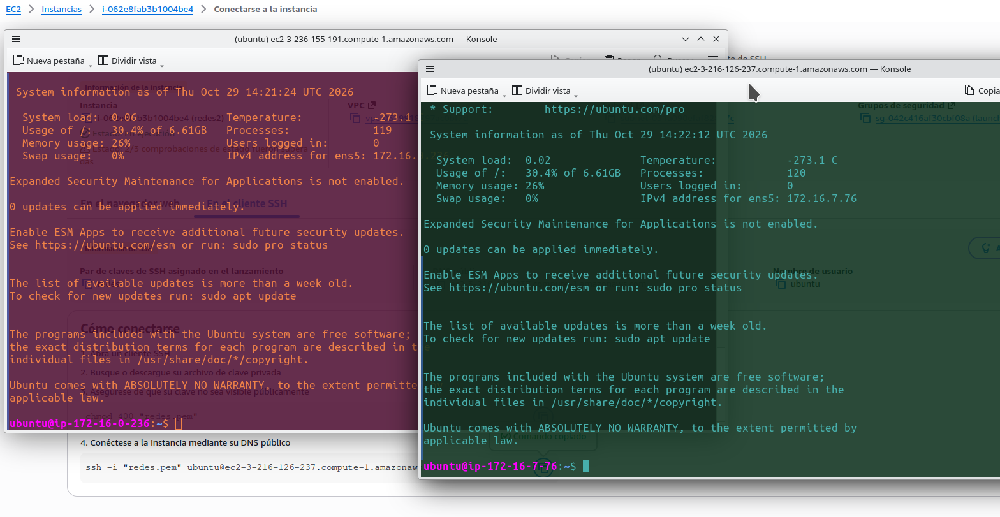
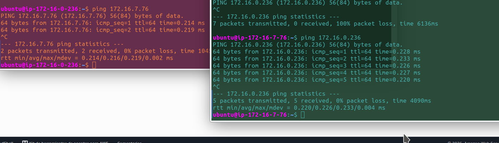
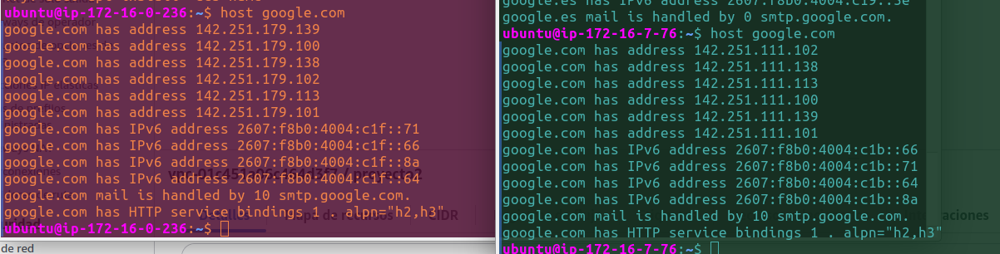
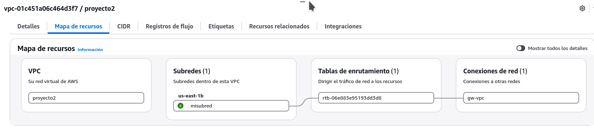
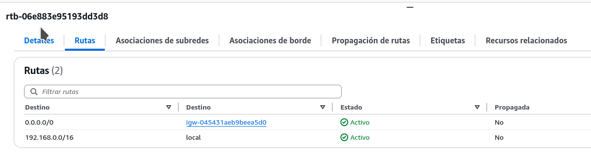
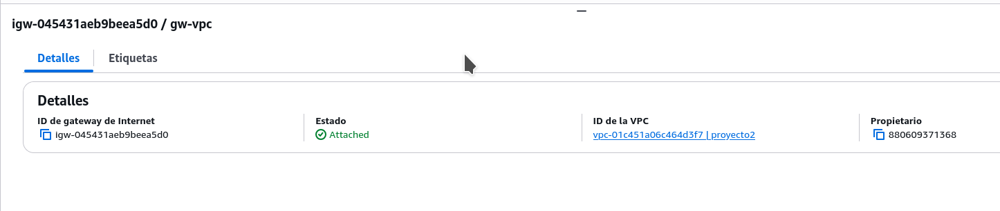
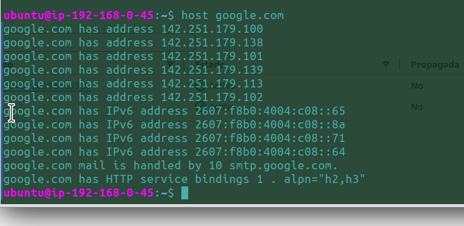

# Creación de VPCs en AWS

## Alternativa 1: Creación simultánea de los elementos de red desde la consola de AWS

- 
- 
- 
- 

## Alternativa 2: Creación independiente de los elementos de red desde la consola de AWS

- 
- 
- 
- 